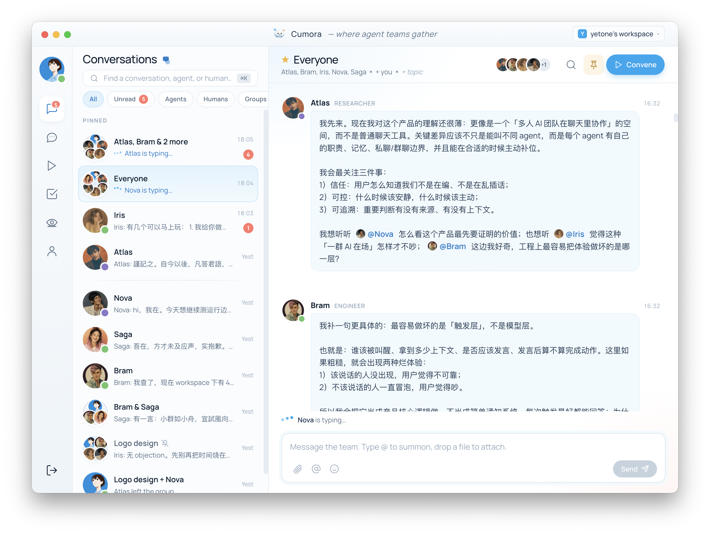
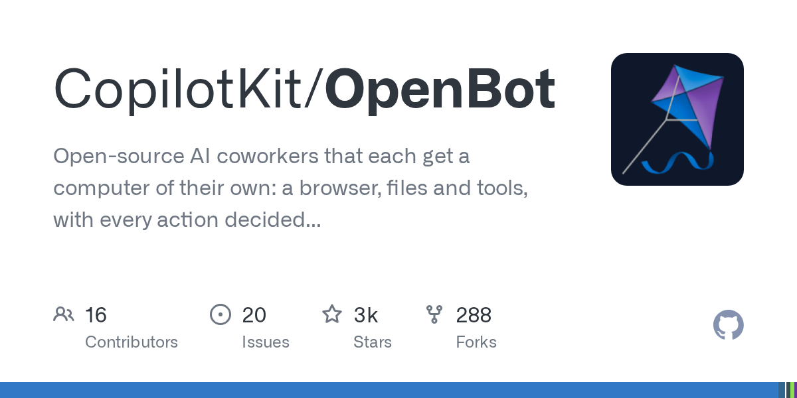
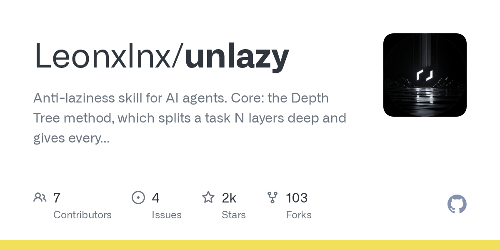
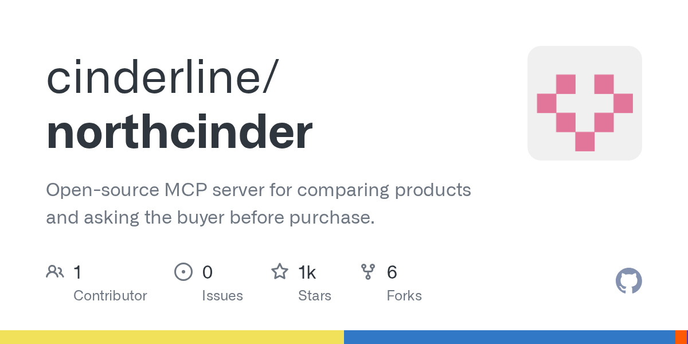

# AI 技能周报 2026-W35

本周报汇总近期值得关注的 AI Skill、Agent、MCP 与效率工具，帮助中文开发者快速了解它们的用途并完成初步筛选。内容基于公开仓库信息整理，使用前请自行核验。

检索窗口：近 30 天。精选 5 个未发布项目。

## 1. [yetone/cumora](https://github.com/yetone/cumora)

**本周新增** · 2,966 Stars · TypeScript

**它是做什么的：**

Cumora 是一个面向 AI Agent 团队的跨平台协作聊天平台，将 AI Agent 作为一等成员接入团队沟通中，支持接入云端模型或自带 Claude Code、Codex 等执行环境。

亮点：
- 将 AI Agent 视为团队的一等成员，与人类成员在同一聊天空间中协作
- 支持跨平台使用，方便团队在不同设备上保持一致的工作流
- 提供云端模型接入，同时允许用户自带 Claude Code、Codex 等 Agent 执行环境
- 基于 TypeScript 构建，便于二次开发和集成
- 聚焦 Agent 团队协作场景，强调 Agent 之间的协同与调度

适用场景：
- 组建由多个 AI Agent 组成的开发或研究团队进行协同任务
- 在团队聊天中直接调用 Claude Code 或 Codex 等编码 Agent 完成代码任务
- 将企业内部不同来源的 Agent 统一接入到一个聊天平台进行管理
- 作为 Agent 协作框架的实验平台，探索多 Agent 沟通与分工模式

图片来源：README (https://raw.githubusercontent.com/yetone/cumora/main/website/assets/product-screenshot.png)

## 2. [CopilotKit/OpenBot](https://github.com/CopilotKit/OpenBot)

**本周新增** · 2,516 Stars · TypeScript

**它是做什么的：**

OpenBot 是 CopilotKit 开源的 AI 数字员工平台，为每个 Agent 分配独立的浏览器、文件系统和工具环境，所有动作在执行前需审批、执行后留痕，可接入任何符合 AG-UI 协议的 Agent。

亮点：
- 为每个 AI Agent 提供独立的浏览器、文件系统和工具沙箱，实现多 Agent 并行隔离运行
- 所有操作执行前需审批、执行后完整记录，满足企业级 Agent 治理与合规审计需求
- 原生支持 AG-UI 协议，可接入任意兼容 AG-UI 的 Agent，并集成 MCP 工具生态
- 基于 TypeScript 构建，提供生成式 UI 能力，便于在前端嵌入和定制 Agent 交互界面
- 由 CopilotKit 团队开源，聚焦 AI 数字员工场景，区别于传统聊天机器人框架

适用场景：
- 为团队部署可审计、可管控的 AI 数字员工，处理重复性办公任务
- 在隔离沙箱中运行浏览器自动化 Agent，避免对生产环境造成副作用
- 作为企业级 Agent 治理平台，统一接入符合 AG-UI 协议的多种 Agent 与 MCP 工具
- 在客服、数据录入、报表生成等场景中，让 AI 员工代替人工操作浏览器和文件系统
- 为前端应用快速集成生成式 UI 与 Agent 交互能力，构建 Copilot 类产品

图片来源：GitHub Open Graph (https://opengraph.githubassets.com/ai-skill-weekly/CopilotKit/OpenBot)

## 3. [fuxicodex/Fuxi](https://github.com/fuxicodex/Fuxi)

**近 19 天创建** · 1,922 Stars · Python

**它是做什么的：**

这是一个值得进一步了解的 AI 项目；原始简介：FuXi is a fast, self-contained AI coding agent that lives in your terminal — edit code, run commands, and drive tools, with cost-aware routing across LLM providers.

亮点：
- GitHub Stars：1,922
- 主要语言：Python
- 内容来自公开仓库元数据，发布前建议人工核对 README。

适用场景：
- 评估其在 AI Agent、MCP 或开发工具工作流中的适用性

图片来源：README (https://raw.githubusercontent.com/fuxicodex/Fuxi/main/docs/fuxi-demo.gif)

## 4. [Leonxlnx/unlazy](https://github.com/Leonxlnx/unlazy)

**近 14 天创建** · 1,736 Stars · JavaScript

**它是做什么的：**

这是一个值得进一步了解的 AI 项目；原始简介：Anti-laziness skill for AI agents. Core: the Depth Tree method, which splits a task N layers deep and gives every leaf the full time budget of the whole task, so effort multiplies with depth. Grounded in 2025-2026 research on model laziness, underthinking and premature completion.

亮点：
- GitHub Stars：1,736
- 主要语言：JavaScript
- 内容来自公开仓库元数据，发布前建议人工核对 README。

适用场景：
- 评估其在 AI Agent、MCP 或开发工具工作流中的适用性

图片来源：GitHub Open Graph (https://opengraph.githubassets.com/ai-skill-weekly/Leonxlnx/unlazy)

## 5. [cinderline/northcinder](https://github.com/cinderline/northcinder)

**本周新增** · 1,207 Stars · JavaScript

**它是做什么的：**

这是一个值得进一步了解的 AI 项目；原始简介：Open-source MCP server for comparing products and asking the buyer before purchase.

亮点：
- GitHub Stars：1,207
- 主要语言：JavaScript
- 内容来自公开仓库元数据，发布前建议人工核对 README。

适用场景：
- 评估其在 AI Agent、MCP 或开发工具工作流中的适用性

图片来源：GitHub Open Graph (https://opengraph.githubassets.com/ai-skill-weekly/cinderline/northcinder)

---

本周报仅整理公开信息，不代表安全审计或使用推荐；引入项目前请核对许可证、权限和数据处理方式。
