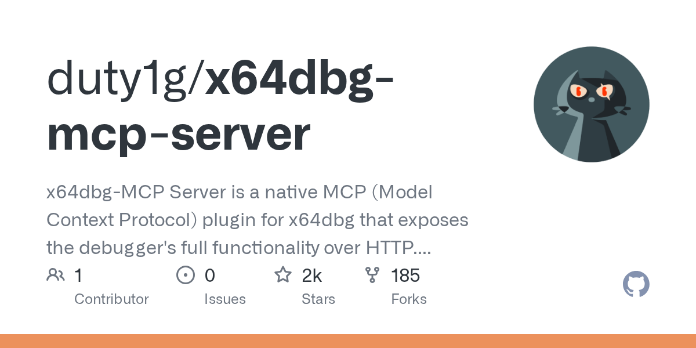
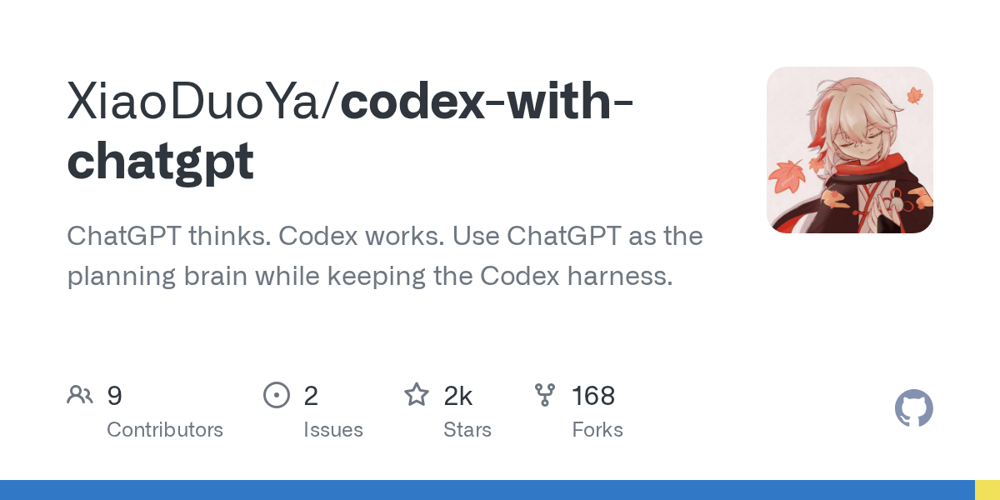
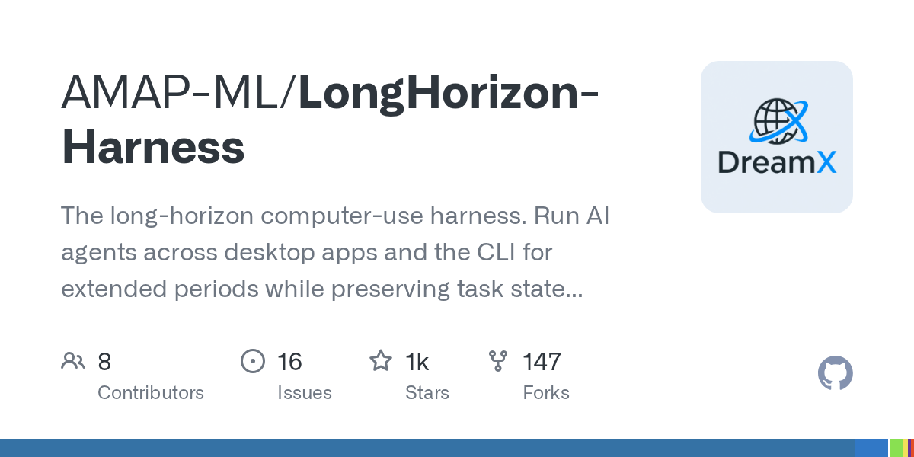
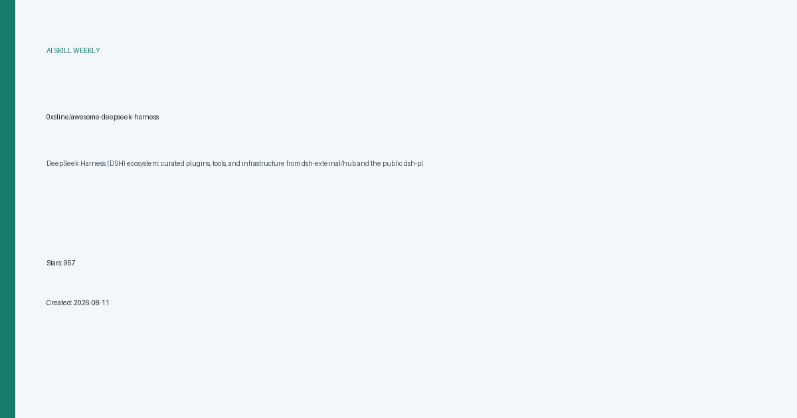

# AI 技能周报 2026-W36

本周报汇总近期值得关注的 AI Skill、Agent、MCP 与效率工具，帮助中文开发者快速了解它们的用途并完成初步筛选。内容基于公开仓库信息整理，使用前请自行核验。

检索窗口：近 30 天。精选 5 个未发布项目。

## 1. [duty1g/x64dbg-mcp-server](https://github.com/duty1g/x64dbg-mcp-server)

**近 8 天创建** · 1,790 Stars · Zig

**它是做什么的：**

这是一个值得进一步了解的 AI 项目；原始简介：x64dbg-MCP Server is a native MCP (Model Context Protocol) plugin for x64dbg that exposes the debugger's full functionality over HTTP. Connect any MCP-compatible AI assistant and control x64dbg programmatically: set breakpoints, step through code, read memory, dump registers, and more.  Built with Zig — zero dependencies, single-binary output, cros

亮点：
- GitHub Stars：1,790
- 主要语言：Zig
- 内容来自公开仓库元数据，发布前建议人工核对 README。

适用场景：
- 评估其在 AI Agent、MCP 或开发工具工作流中的适用性

图片来源：GitHub Open Graph (https://opengraph.githubassets.com/ai-skill-weekly/duty1g/x64dbg-mcp-server)

## 2. [XiaoDuoYa/codex-with-chatgpt](https://github.com/XiaoDuoYa/codex-with-chatgpt)

**本周新增** · 1,544 Stars · TypeScript

**它是做什么的：**

codex-with-chatgpt 是一个把 ChatGPT 作为规划大脑、Codex CLI 作为执行终端的桥接项目，让用户可以在保留 Codex 命令行体验的同时，用 ChatGPT 来拆解任务、生成方案并驱动 Codex 完成实际编码工作。

亮点：
- 将 ChatGPT 的对话式规划能力与 Codex CLI 的代码执行能力组合在同一工作流中
- 支持通过 OAuth 登录复用现有 ChatGPT 账号，无需额外部署模型服务
- 兼容 Model Context Protocol（MCP），可接入外部工具与上下文
- 基于 TypeScript 实现，便于在本地或自托管环境中扩展和定制
- 面向 AI Agent 场景，强调让模型负责思考、CLI 负责落地的分工模式

适用场景：
- 在终端里用自然语言描述需求，由 ChatGPT 拆解后交给 Codex 执行编码与文件操作
- 为已有的 Codex CLI 工作流补充更强的任务规划与多轮对话能力
- 作为 MCP 客户端示例，演示如何把 ChatGPT 接入支持 MCP 的工具生态
- 用于个人或小团队的 AI 辅助开发实验，验证 ChatGPT + Codex 的协同效果

图片来源：GitHub Open Graph (https://opengraph.githubassets.com/ai-skill-weekly/XiaoDuoYa/codex-with-chatgpt)

## 3. [lexmount/moli](https://github.com/lexmount/moli)

**近 20 天创建** · 1,509 Stars · Rust

**它是做什么的：**

这是一个值得进一步了解的 AI 项目；原始简介：Best headless browser for AI agents. Lite, Fast, High-Compatibility. Built in Rust

亮点：
- GitHub Stars：1,509
- 主要语言：Rust
- 内容来自公开仓库元数据，发布前建议人工核对 README。

适用场景：
- 评估其在 AI Agent、MCP 或开发工具工作流中的适用性

图片来源：本地信息卡 (本地生成)

## 4. [AMAP-ML/LongHorizon-Harness](https://github.com/AMAP-ML/LongHorizon-Harness)

**近 27 天创建** · 1,412 Stars · Python

**它是做什么的：**

这是一个值得进一步了解的 AI 项目；原始简介：The long-horizon computer-use harness. Run AI agents across desktop apps and the CLI for extended periods while preserving task state and making reliable progress on complex workflows. Features fresh-context execution, durable verified state, independent auditing, recoverable progress, and native Claude Code / Codex / OpenClaw integration.

亮点：
- GitHub Stars：1,412
- 主要语言：Python
- 内容来自公开仓库元数据，发布前建议人工核对 README。

适用场景：
- 评估其在 AI Agent、MCP 或开发工具工作流中的适用性

图片来源：GitHub Open Graph (https://opengraph.githubassets.com/ai-skill-weekly/AMAP-ML/LongHorizon-Harness)

## 5. [0xsline/awesome-deepseek-harness](https://github.com/0xsline/awesome-deepseek-harness)

**近 19 天创建** · 957 Stars · Python

**它是做什么的：**

DeepSeek Harness（DSH）生态的精选资源汇总，整理了围绕 DeepSeek 大模型的插件、工具与基础设施，方便开发者快速发现和接入可复用的能力扩展。

亮点：
- 围绕 DeepSeek 大模型构建的 Harness 框架与插件生态（DSH）
- 整合 dsh-external/hub 与 dsh-plugin 公开主题下的精选资源
- 覆盖 AI Agent、MCP、编码助手等开发者工具方向
- 提供 curated list 形式的插件与基础设施索引，便于发现和选型
- 以 Python 生态为主，兼顾 LLM 与 AI Agent 相关项目

适用场景：
- 为 DeepSeek 模型选型合适的插件、工具或基础设施
- 在 AI Agent / MCP 项目中查找可复用的 DSH 组件
- 为编码助手类应用寻找基于 DeepSeek 的扩展能力
- 作为团队评估 DeepSeek 周边生态的参考清单
- 快速了解 DeepSeek Harness 生态的整体构成与社区资源

图片来源：本地信息卡 (本地生成)

---

本周报仅整理公开信息，不代表安全审计或使用推荐；引入项目前请核对许可证、权限和数据处理方式。
