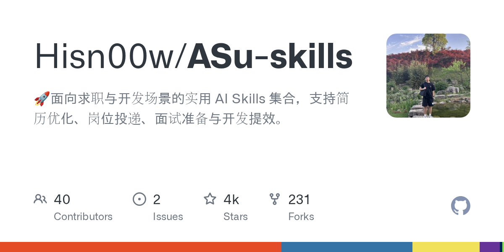
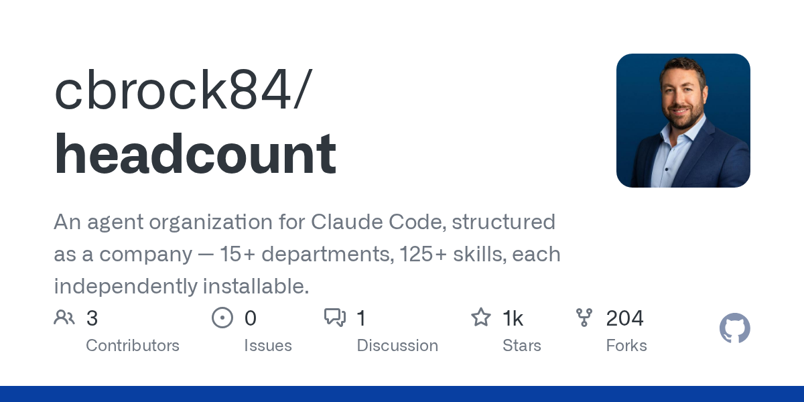
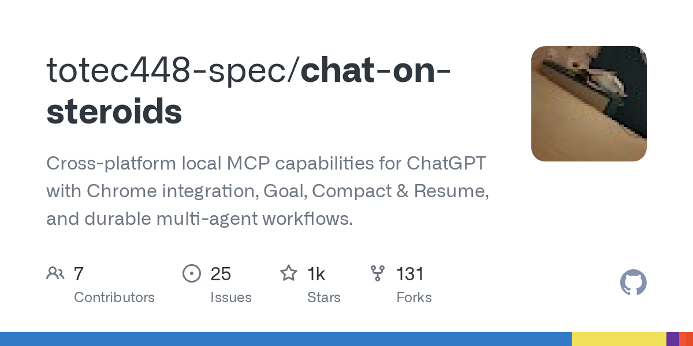
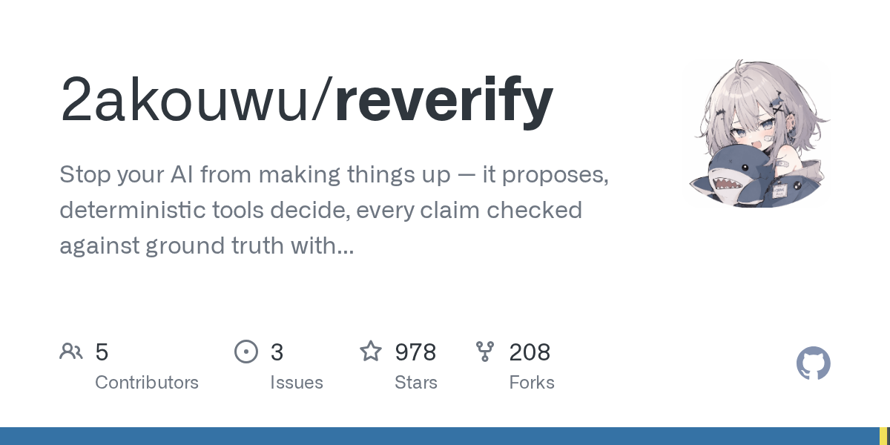

# AI 技能周报 2026-W37

本周报汇总近期值得关注的 AI Skill、Agent、MCP 与效率工具，帮助中文开发者快速了解它们的用途并完成初步筛选。内容基于公开仓库信息整理，使用前请自行核验。

检索窗口：近 30 天。精选 5 个未发布项目。

## 1. [Hisn00w/ASu-skills](https://github.com/Hisn00w/ASu-skills)

**近 25 天创建** · 3,771 Stars · HTML

**它是做什么的：**

ASu-skills 是一个面向求职与开发场景的 AI Skills 集合，提供简历优化、岗位投递、面试准备与开发提效等实用工具，帮助求职者和开发者更高效地完成日常任务。

亮点：
- 聚焦求职与开发两大高频场景，整合简历优化、岗位投递、面试准备等实用 AI Skills
- 支持开发提效，覆盖编码、调试等常见工作流
- 以 Skills 形式封装，可按需调用，便于集成到 AI Agent 或 MCP 工作流中
- 项目使用 HTML 编写说明文档，结构清晰、上手成本低
- 在 GitHub 上获得超过 3700 Star，受到中文开发者社区关注

适用场景：
- 求职者使用 AI Skills 优化简历内容、匹配岗位 JD 并辅助生成求职信
- 面试前进行模拟问答、梳理技术要点与项目经验
- 开发者借助 Skills 提升编码、调试与文档编写等日常开发效率
- 将项目中的 Skills 集成到自有 AI Agent 或 MCP 工具链中
- 作为中文 AI Skills 资源参考，用于学习如何构建面向场景的 Agent 能力包

图片来源：GitHub Open Graph (https://opengraph.githubassets.com/ai-skill-weekly/Hisn00w/ASu-skills)

## 2. [cbrock84/headcount](https://github.com/cbrock84/headcount)

**近 9 天创建** · 1,300 Stars · Markdown

**它是做什么的：**

Headcount 是一个为 Claude Code 设计的“公司化”智能体组织框架，将 15 个以上部门、125 个以上技能拆分为可独立安装的插件，方便按需组合成不同职能的 AI 团队。

亮点：
- 采用公司化结构组织 Claude Code 智能体，覆盖 15+ 部门与 125+ 技能
- 每个部门和技能都封装为独立可安装的插件，支持按需启用
- 作为 Claude Code 插件市场（agent marketplace）使用，便于扩展和复用
- 围绕 MCP 与 Claude Skills 生态构建，兼容现有 Claude Code 工作流
- 以 Markdown 形式组织配置和说明，便于阅读、审阅与二次定制

适用场景：
- 为 Claude Code 快速搭建多角色、多技能的虚拟团队，按部门加载所需能力
- 在企业或团队内部按职能（如开发、测试、运维、文档等）分发和复用 AI 技能包
- 作为插件市场，集中管理 Claude Code 的扩展、技能与 MCP 集成
- 通过独立安装的部门/技能插件，按项目需要灵活组合 AI 助手能力
- 为研究和学习 Claude Code 插件机制、MCP 协议与智能体编排提供参考实现

图片来源：GitHub Open Graph (https://opengraph.githubassets.com/ai-skill-weekly/cbrock84/headcount)

## 3. [totec448-spec/chat-on-steroids](https://github.com/totec448-spec/chat-on-steroids)

**近 15 天创建** · 1,068 Stars · TypeScript

**它是做什么的：**

Chat-on-Steroids 是一个本地优先的跨平台 MCP 客户端，为 ChatGPT 桌面端与浏览器扩展提供 Chrome 集成、目标驱动、上下文压缩与恢复以及持久化的多智能体工作流能力。

亮点：
- 基于 Electron 与 Chrome 扩展，支持 Windows、macOS 与 Linux 三大桌面平台
- 通过本地 MCP 协议接入工具与数据源，避免依赖云端中转，强调 local-first 隐私与可控性
- 内置 Goal、Compact & Resume 机制，可将长对话压缩后继续推进并保留目标上下文
- 支持 durable multi-agent workflows，多个智能体可协同完成跨步骤任务并持久化执行状态
- 使用 TypeScript 开发，便于二次定制与扩展 MCP 工具

适用场景：
- 在本地 ChatGPT 客户端中调用 MCP 工具完成代码、文档与浏览器操作自动化
- 为长周期研究或开发任务设定目标，中途压缩上下文后继续推进而不丢失主线
- 搭建可持久执行的多智能体流水线，例如自动抓取网页、汇总信息并生成报告
- 在 Windows、macOS 或 Linux 桌面环境中统一管理 ChatGPT 会话与外部工具调用
- 作为本地 MCP 客户端参考实现，用于学习 Electron + Chrome 扩展 + MCP 的集成方式

图片来源：GitHub Open Graph (https://opengraph.githubassets.com/ai-skill-weekly/totec448-spec/chat-on-steroids)

## 4. [pgrundev/pgbot](https://github.com/pgrundev/pgbot)

**近 26 天创建** · 985 Stars · Go

**它是做什么的：**

pgbot 是一个面向 AI Agent 与应用的 PostgreSQL 智能层，让大模型能够安全、可控地查询和分析 Postgres 数据库。它通过自然语言接口把数据库能力暴露给 AI Agent，简化数据访问与洞察生成的流程。

亮点：
- 为 AI Agent 提供 Postgres 智能接入，支持自然语言驱动的数据查询与分析
- 聚焦 PostgreSQL 生态，深度适配数据库特性，便于在现有 Postgres 环境中部署
- 以 Go 实现，具备良好的性能与可扩展性，适合作为后端服务组件
- 面向 AI 应用场景设计，可作为 Agent 与数据库之间的中间层，降低集成复杂度
- 开源项目，便于二次开发与定制化改造

适用场景：
- 为 AI Agent 提供安全、受控的 PostgreSQL 数据访问能力
- 在 AI 应用中实现自然语言转 SQL 的数据查询与分析
- 作为数据助手后端，帮助业务人员通过对话方式获取数据库洞察
- 集成到企业内部系统中，让 LLM 应用直接对接 Postgres 数据源
- 用于构建数据库相关的自动化工作流，例如报表生成、异常检测与数据探索

图片来源：本地信息卡 (本地生成)

## 5. [2akouwu/reverify](https://github.com/2akouwu/reverify)

**本周新增** · 978 Stars · Python

**它是做什么的：**

reverify 是一个面向 AI Agent 的 MCP 服务器与命令行工具，通过让 LLM 提出主张、由确定性工具裁决并以证据核对事实，来抑制大模型在逆向工程等场景中的幻觉，让可信的事实和上下文在会话重置后仍可复用。

亮点：
- 主张-裁决-证据三段式：LLM 负责提出可验证主张，确定性工具负责判定，每条结论都附带可追溯的证据
- 面向逆向工程的 MCP 服务器与 CLI，可与二进制分析、静态/动态分析工具链直接对接
- 事实与上下文持久化：经过验证的结论在会话重置或新会话中仍可复用，避免重复推理
- 可作为通用反幻觉层接入 AI 编码与 Agent 工作流，不局限于安全分析
- 用 CTF 与恶意软件分析作为验证场景，强调在对抗性输入下的可靠性

适用场景：
- 在 AI 辅助逆向工程中，对反汇编结果、函数行为、协议字段等主张进行自动核验
- 在 CTF 解题过程中，让 Agent 把每一步推断交给确定性工具验证，减少错误方向
- 在恶意软件分析中，对可疑字符串、解密逻辑、C2 行为等结论提供证据链
- 作为通用 MCP 工具接入 AI 编码助手，对代码理解、依赖行为、API 行为等主张做事实核查
- 在需要长期上下文的 Agent 任务中，沉淀已验证事实，降低重复推理成本

图片来源：GitHub Open Graph (https://opengraph.githubassets.com/ai-skill-weekly/2akouwu/reverify)

---

本周报仅整理公开信息，不代表安全审计或使用推荐；引入项目前请核对许可证、权限和数据处理方式。
