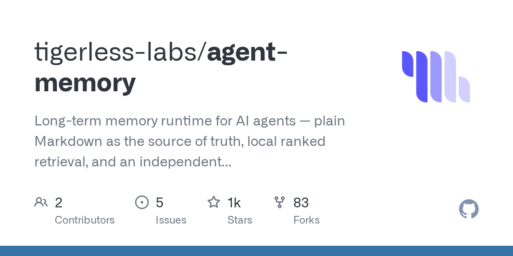
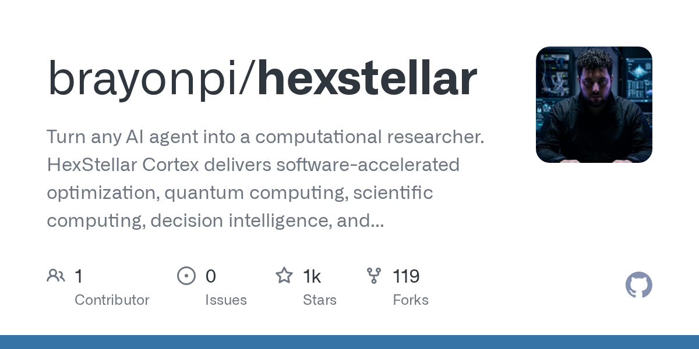
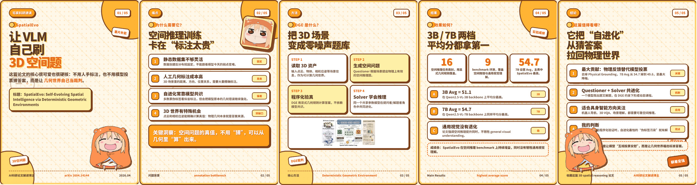
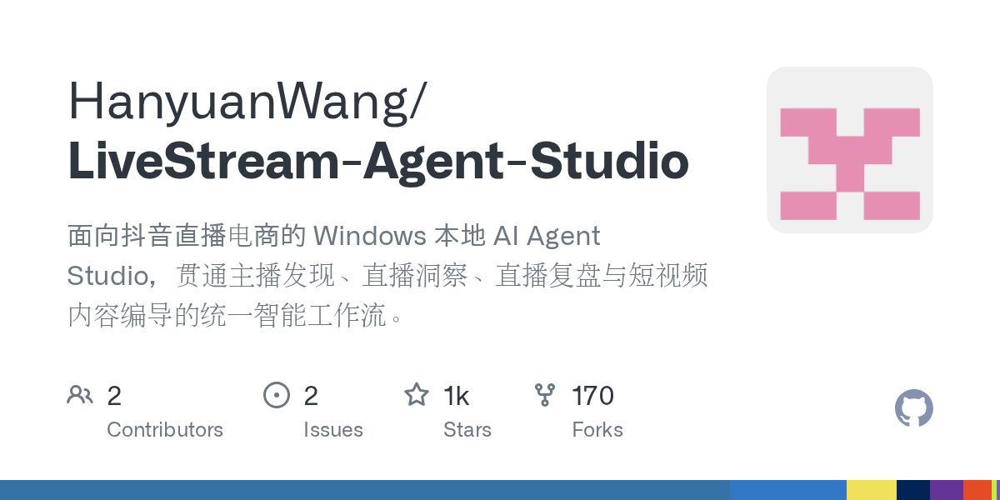
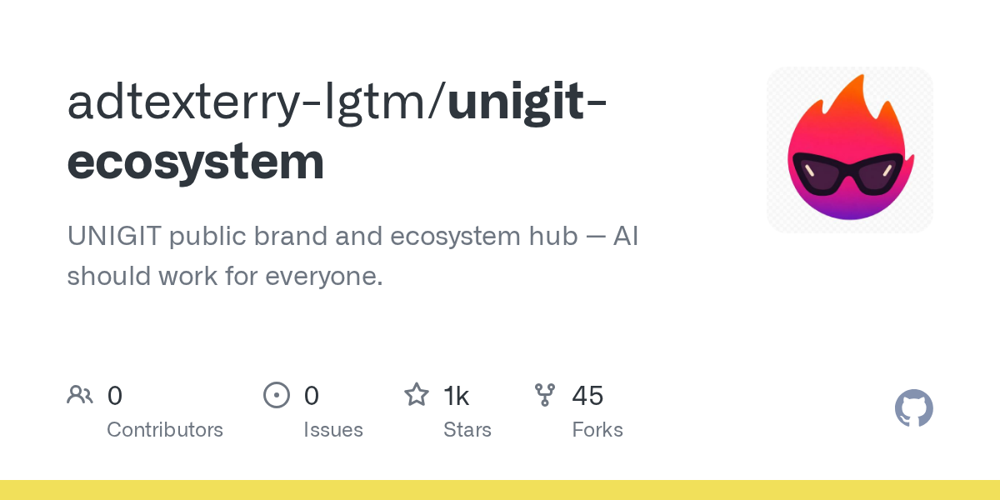

# AI 技能周报 2026-W38

本周报汇总近期值得关注的 AI Skill、Agent、MCP 与效率工具，帮助中文开发者快速了解它们的用途并完成初步筛选。内容基于公开仓库信息整理，使用前请自行核验。

检索窗口：近 30 天。精选 5 个未发布项目。

## 1. [tigerless-labs/agent-memory](https://github.com/tigerless-labs/agent-memory)

**近 12 天创建** · 1,353 Stars · Python

**它是做什么的：**

这是一个值得进一步了解的 AI 项目；原始简介：Long-term memory runtime for AI agents — plain Markdown as the source of truth, local ranked retrieval, and an independent sleep-time Manage layer. Claude Code and Codex share one store. No API key.

亮点：
- GitHub Stars：1,353
- 主要语言：Python
- 内容来自公开仓库元数据，发布前建议人工核对 README。

适用场景：
- 评估其在 AI Agent、MCP 或开发工具工作流中的适用性

图片来源：GitHub Open Graph (https://opengraph.githubassets.com/ai-skill-weekly/tigerless-labs/agent-memory)

## 2. [brayonpi/hexstellar](https://github.com/brayonpi/hexstellar)

**近 17 天创建** · 1,198 Stars · Python

**它是做什么的：**

这是一个值得进一步了解的 AI 项目；原始简介：Turn any AI agent into a computational researcher. HexStellar Cortex delivers software-accelerated optimization, quantum computing, scientific computing, decision intelligence, and verifiable execution through a Python CLI and API—with certainty labels, verification receipts, examples, and a free sandbox. Start instantly: pip install hexstellar

亮点：
- GitHub Stars：1,198
- 主要语言：Python
- 内容来自公开仓库元数据，发布前建议人工核对 README。

适用场景：
- 评估其在 AI Agent、MCP 或开发工具工作流中的适用性

图片来源：GitHub Open Graph (https://opengraph.githubassets.com/ai-skill-weekly/brayonpi/hexstellar)

## 3. [ZJU-REAL/Easel](https://github.com/ZJU-REAL/Easel)

**近 17 天创建** · 1,062 Stars · Python

**它是做什么的：**

这是一个值得进一步了解的 AI 项目；原始简介：An open-source AI agent for social media — discover trends, create content, publish everywhere, and learn what works across Xiaohongshu, Douyin, Zhihu, Bilibili, and more.🎨一个开源的 AI 社交媒体智能体——发现热点趋势、创作内容、一键发布至各大平台，并学习分析哪些内容真正有效，覆盖小红书、抖音、知乎、哔哩哔哩等平台。

亮点：
- GitHub Stars：1,062
- 主要语言：Python
- 内容来自公开仓库元数据，发布前建议人工核对 README。

适用场景：
- 评估其在 AI Agent、MCP 或开发工具工作流中的适用性

图片来源：README (https://raw.githubusercontent.com/ZJU-REAL/Easel/main/assets/readme/showcase/spatialevo-cards-strip.jpg)

## 4. [HanyuanWang/LiveStream-Agent-Studio](https://github.com/HanyuanWang/LiveStream-Agent-Studio)

**近 22 天创建** · 1,019 Stars · Python

**它是做什么的：**

这是一个值得进一步了解的 AI 项目；原始简介：面向抖音直播电商的 Windows 本地 AI Agent Studio，贯通主播发现、直播洞察、直播复盘与短视频内容编导的统一智能工作流。

亮点：
- GitHub Stars：1,019
- 主要语言：Python
- 内容来自公开仓库元数据，发布前建议人工核对 README。

适用场景：
- 评估其在 AI Agent、MCP 或开发工具工作流中的适用性

图片来源：GitHub Open Graph (https://opengraph.githubassets.com/ai-skill-weekly/HanyuanWang/LiveStream-Agent-Studio)

## 5. [adtexterry-lgtm/unigit-ecosystem](https://github.com/adtexterry-lgtm/unigit-ecosystem)

**近 11 天创建** · 1,009 Stars · JavaScript

**它是做什么的：**

这是一个值得进一步了解的 AI 项目；原始简介：UNIGIT public brand and ecosystem hub — AI should work for everyone.

亮点：
- GitHub Stars：1,009
- 主要语言：JavaScript
- 内容来自公开仓库元数据，发布前建议人工核对 README。

适用场景：
- 评估其在 AI Agent、MCP 或开发工具工作流中的适用性

图片来源：GitHub Open Graph (https://opengraph.githubassets.com/ai-skill-weekly/adtexterry-lgtm/unigit-ecosystem)

---

本周报仅整理公开信息，不代表安全审计或使用推荐；引入项目前请核对许可证、权限和数据处理方式。
