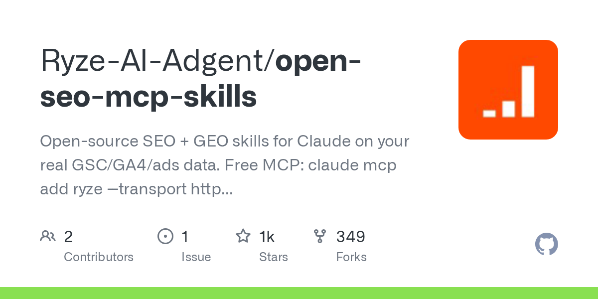
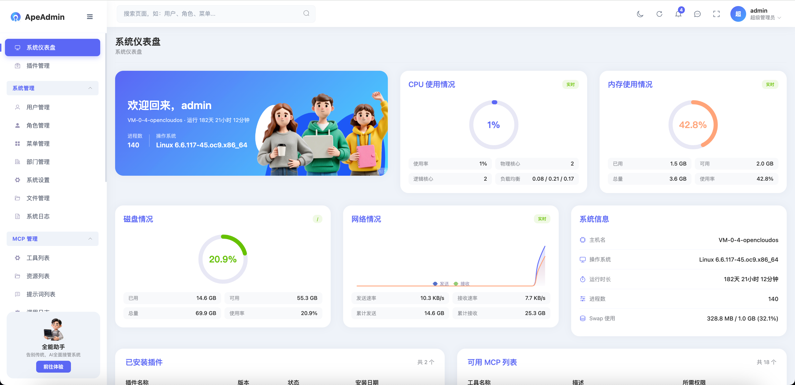
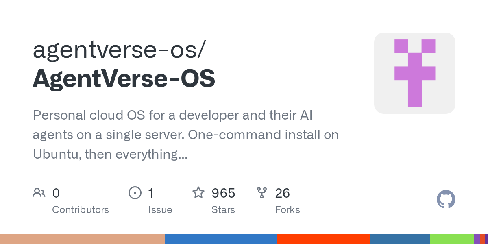
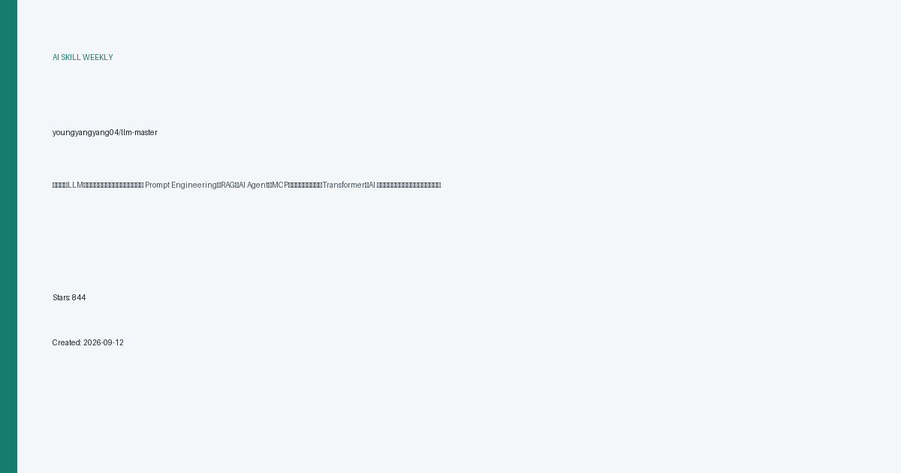

# AI 技能周报 2026-W39

本周报汇总近期值得关注的 AI Skill、Agent、MCP 与效率工具，帮助中文开发者快速了解它们的用途并完成初步筛选。内容基于公开仓库信息整理，使用前请自行核验。

检索窗口：近 30 天。精选 5 个未发布项目。

## 1. [jub0t/Concat](https://github.com/jub0t/Concat)

**近 26 天创建** · 3,054 Stars · Rust

**它是做什么的：**

这是一个值得进一步了解的 AI 项目；原始简介：Free & Open-Source CapCut replacement (supports MCPs).

亮点：
- GitHub Stars：3,054
- 主要语言：Rust
- 内容来自公开仓库元数据，发布前建议人工核对 README。

适用场景：
- 评估其在 AI Agent、MCP 或开发工具工作流中的适用性

图片来源：本地信息卡 (本地生成)

## 2. [Ryze-AI-Adgent/open-seo-mcp-skills](https://github.com/Ryze-AI-Adgent/open-seo-mcp-skills)

**近 22 天创建** · 1,091 Stars · Shell

**它是做什么的：**

这是一个值得进一步了解的 AI 项目；原始简介：Open-source SEO + GEO skills for Claude on your real GSC/GA4/ads data. Free MCP: claude mcp add ryze --transport http https://connector.get-ryze.ai/mcp

亮点：
- GitHub Stars：1,091
- 主要语言：Shell
- 内容来自公开仓库元数据，发布前建议人工核对 README。

适用场景：
- 评估其在 AI Agent、MCP 或开发工具工作流中的适用性

图片来源：GitHub Open Graph (https://opengraph.githubassets.com/ai-skill-weekly/Ryze-AI-Adgent/open-seo-mcp-skills)

## 3. [KevinLiss/ApeAdmin](https://github.com/KevinLiss/ApeAdmin)

**近 26 天创建** · 1,004 Stars · Python

**它是做什么的：**

这是一个值得进一步了解的 AI 项目；原始简介：Apeadmin 面向现代AI应用打造的Python后台管理框架，基于 FastAPI+Vue3 设计100%开源，内置 RBAC 权限管控、审计日志等企业级基础能力。框架集成 MCP‑SSE 网关，具备强大插件生态完整，帮助开发者快速搭建兼具业务管理与 AI 工具输出能力的应用。

亮点：
- GitHub Stars：1,004
- 主要语言：Python
- 内容来自公开仓库元数据，发布前建议人工核对 README。

适用场景：
- 评估其在 AI Agent、MCP 或开发工具工作流中的适用性

图片来源：README (https://raw.githubusercontent.com/KevinLiss/ApeAdmin/master/assets/screenshots/login.png)

## 4. [agentverse-os/AgentVerse-OS](https://github.com/agentverse-os/AgentVerse-OS)

**近 8 天创建** · 965 Stars · Rust

**它是做什么的：**

这是一个值得进一步了解的 AI 项目；原始简介：Personal cloud OS for a developer and their AI agents on a single server. One-command install on Ubuntu, then everything in the browser: a windowed desktop, isolated workspaces with VS Code, Claude Code and Codex, a store of 944 self-hosted apps, backups and updates. Access only via Tailscale, nothing exposed to the internet. Rust core, Svelte UI.

亮点：
- GitHub Stars：965
- 主要语言：Rust
- 内容来自公开仓库元数据，发布前建议人工核对 README。

适用场景：
- 评估其在 AI Agent、MCP 或开发工具工作流中的适用性

图片来源：GitHub Open Graph (https://opengraph.githubassets.com/ai-skill-weekly/agentverse-os/AgentVerse-OS)

## 5. [youngyangyang04/llm-master](https://github.com/youngyangyang04/llm-master)

**近 8 天创建** · 844 Stars · 语言未标注

**它是做什么的：**

这是一个值得进一步了解的 AI 项目；原始简介：大模型（LLM）全栈学习路线与中文教程🔥：覆盖 Prompt Engineering、RAG、AI Agent、MCP、微调、模型部署、Transformer、AI 编程与大厂面试，从入门到生产实践。

亮点：
- GitHub Stars：844
- 主要语言：未标注
- 内容来自公开仓库元数据，发布前建议人工核对 README。

适用场景：
- 评估其在 AI Agent、MCP 或开发工具工作流中的适用性

图片来源：本地信息卡 (本地生成)

---

本周报仅整理公开信息，不代表安全审计或使用推荐；引入项目前请核对许可证、权限和数据处理方式。
