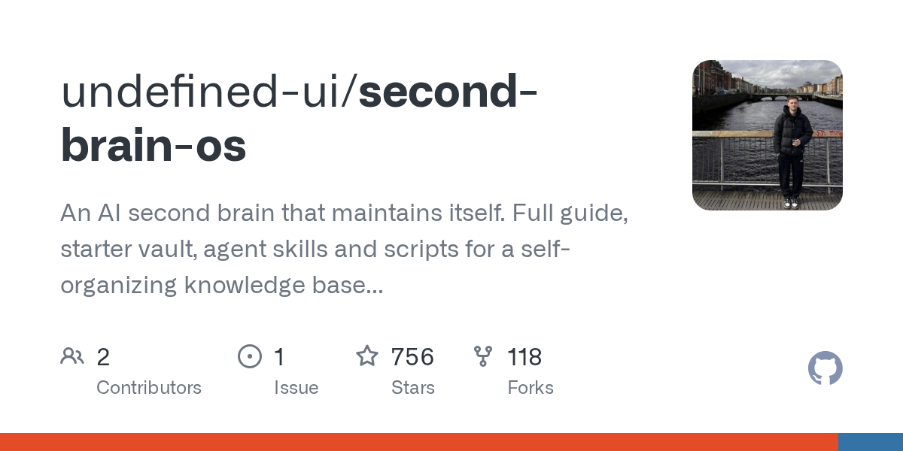
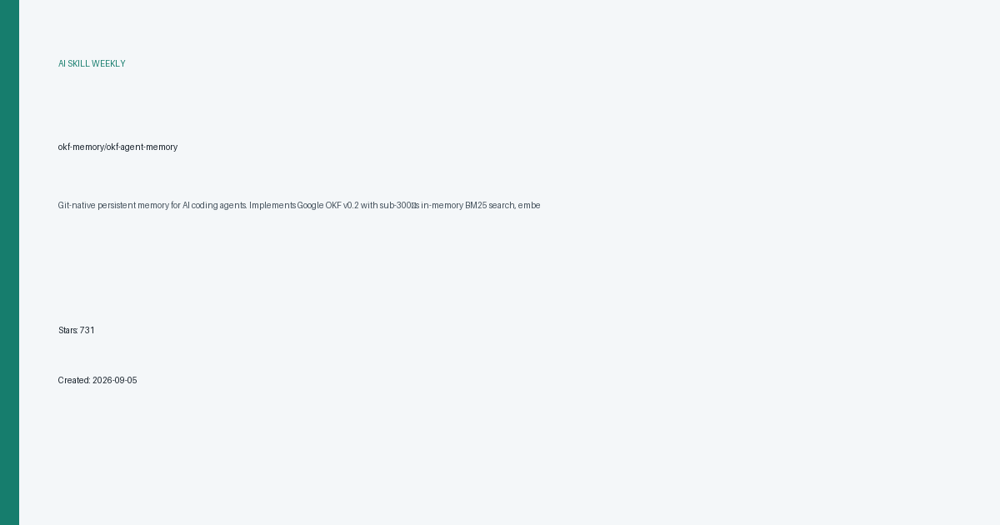
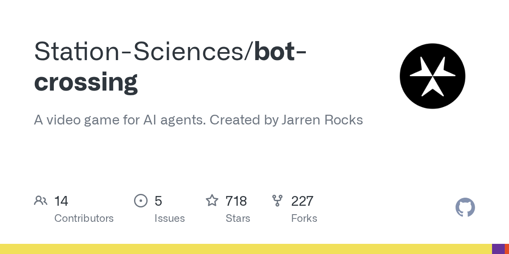

# AI 技能周报 2026-W40

本周报汇总近期值得关注的 AI Skill、Agent、MCP 与效率工具，帮助中文开发者快速了解它们的用途并完成初步筛选。内容基于公开仓库信息整理，使用前请自行核验。

检索窗口：近 30 天。精选 5 个未发布项目。

## 1. [freestylefly/WeChatBridge](https://github.com/freestylefly/WeChatBridge)

**本周新增** · 853 Stars · Swift

**它是做什么的：**

这是一个值得进一步了解的 AI 项目；原始简介：微信聊天记录一键转发到 AI Agent 与 Obsidian 的原生 macOS 工具

亮点：
- GitHub Stars：853
- 主要语言：Swift
- 内容来自公开仓库元数据，发布前建议人工核对 README。

适用场景：
- 评估其在 AI Agent、MCP 或开发工具工作流中的适用性

图片来源：README (https://raw.githubusercontent.com/freestylefly/WeChatBridge/main/Resources/Screenshots/app-icon-rounded.png)

## 2. [undefined-ui/second-brain-os](https://github.com/undefined-ui/second-brain-os)

**近 20 天创建** · 756 Stars · HTML

**它是做什么的：**

这是一个值得进一步了解的 AI 项目；原始简介：An AI second brain that maintains itself. Full guide, starter vault, agent skills and scripts for a self-organizing knowledge base in Claude Code and Obsidian.

亮点：
- GitHub Stars：756
- 主要语言：HTML
- 内容来自公开仓库元数据，发布前建议人工核对 README。

适用场景：
- 评估其在 AI Agent、MCP 或开发工具工作流中的适用性

图片来源：GitHub Open Graph (https://opengraph.githubassets.com/ai-skill-weekly/undefined-ui/second-brain-os)

## 3. [qiz029/dscode](https://github.com/qiz029/dscode)

**近 16 天创建** · 735 Stars · JavaScript

**它是做什么的：**

这是一个值得进一步了解的 AI 项目；原始简介：A DeepSeek coding agent harness: persistent shell, Ultra subagents, auto approval, Chrome MCP and session telemetry

亮点：
- GitHub Stars：735
- 主要语言：JavaScript
- 内容来自公开仓库元数据，发布前建议人工核对 README。

适用场景：
- 评估其在 AI Agent、MCP 或开发工具工作流中的适用性

图片来源：README (https://raw.githubusercontent.com/qiz029/dscode/main/assets/demo.gif)

## 4. [okf-memory/okf-agent-memory](https://github.com/okf-memory/okf-agent-memory)

**近 22 天创建** · 731 Stars · Go

**它是做什么的：**

这是一个值得进一步了解的 AI 项目；原始简介：Git-native persistent memory for AI coding agents. Implements Google OKF v0.2 with sub-300µs in-memory BM25 search, embedded MCP server, and progressive disclosure. Slashes token bloat by 80% with zero external databases or dependencies. Built in pure Go.

亮点：
- GitHub Stars：731
- 主要语言：Go
- 内容来自公开仓库元数据，发布前建议人工核对 README。

适用场景：
- 评估其在 AI Agent、MCP 或开发工具工作流中的适用性

图片来源：本地信息卡 (本地生成)

## 5. [Station-Sciences/bot-crossing](https://github.com/Station-Sciences/bot-crossing)

**近 26 天创建** · 718 Stars · JavaScript

**它是做什么的：**

这是一个值得进一步了解的 AI 项目；原始简介：A video game for AI agents. Created by Jarren Rocks

亮点：
- GitHub Stars：718
- 主要语言：JavaScript
- 内容来自公开仓库元数据，发布前建议人工核对 README。

适用场景：
- 评估其在 AI Agent、MCP 或开发工具工作流中的适用性

图片来源：GitHub Open Graph (https://opengraph.githubassets.com/ai-skill-weekly/Station-Sciences/bot-crossing)

---

本周报仅整理公开信息，不代表安全审计或使用推荐；引入项目前请核对许可证、权限和数据处理方式。
