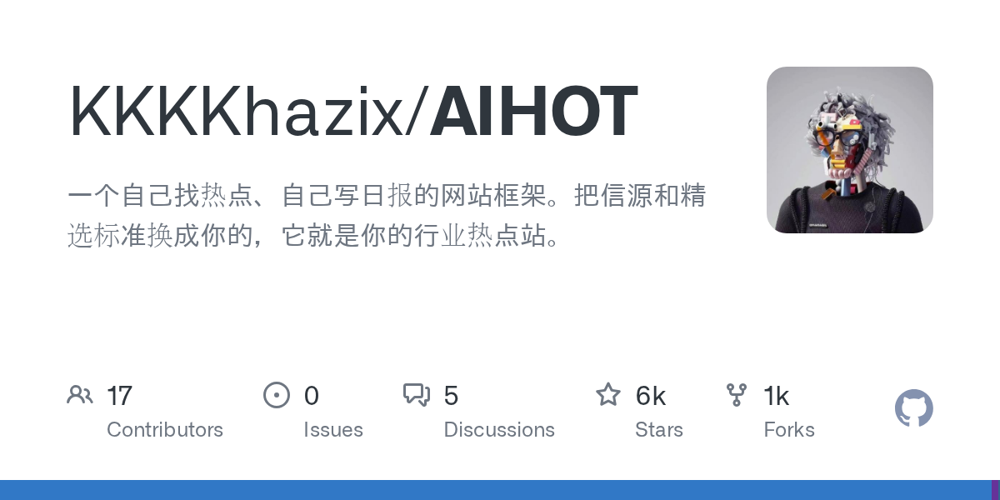
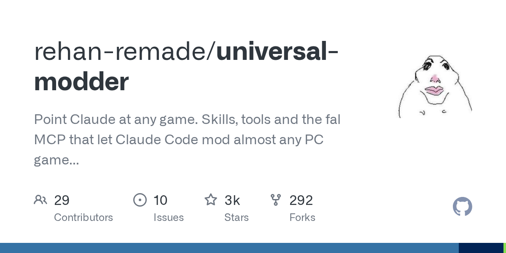
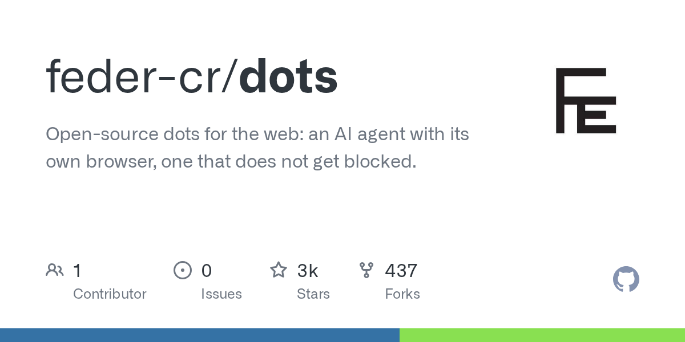
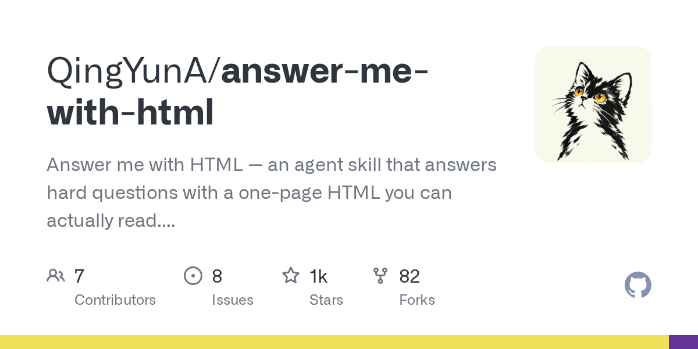
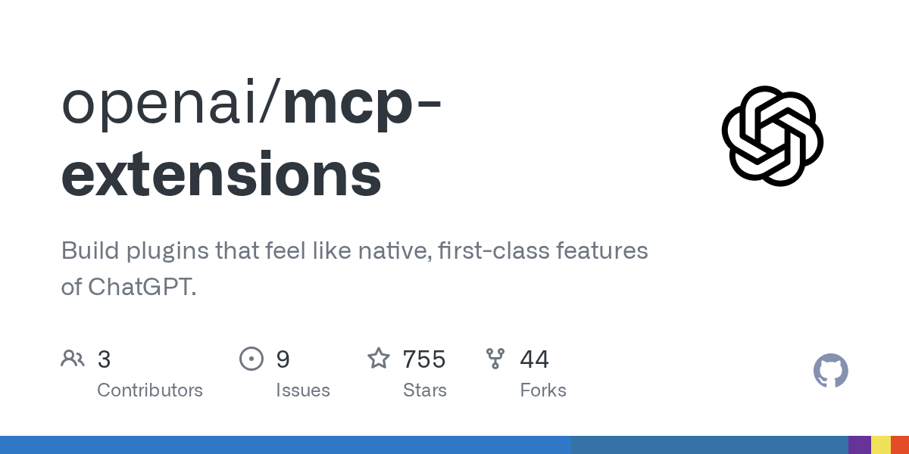

# AI 技能周报 2026-W41

本周报汇总近期值得关注的 AI Skill、Agent、MCP 与效率工具，帮助中文开发者快速了解它们的用途并完成初步筛选。内容基于公开仓库信息整理，使用前请自行核验。

检索窗口：近 7 天。精选 5 个未发布项目。

## 1. [KKKKhazix/AIHOT](https://github.com/KKKKhazix/AIHOT)

**本周新增** · 5,848 Stars · TypeScript

**它是做什么的：**

这是一个值得进一步了解的 AI 项目；原始简介：一个自己找热点、自己写日报的网站框架。把信源和精选标准换成你的，它就是你的行业热点站。

亮点：
- GitHub Stars：5,848
- 主要语言：TypeScript
- 内容来自公开仓库元数据，发布前建议人工核对 README。

适用场景：
- 评估其在 AI Agent、MCP 或开发工具工作流中的适用性

图片来源：GitHub Open Graph (https://opengraph.githubassets.com/ai-skill-weekly/KKKKhazix/AIHOT)

## 2. [rehan-remade/universal-modder](https://github.com/rehan-remade/universal-modder)

**本周新增** · 3,386 Stars · Python

**它是做什么的：**

这是一个值得进一步了解的 AI 项目；原始简介：Point Claude at any game. Skills, tools and the fal MCP that let Claude Code mod almost any PC game you own: recon, reverse engineering, fal-generated art/3D/audio, in-game testing, showcase videos.

亮点：
- GitHub Stars：3,386
- 主要语言：Python
- 内容来自公开仓库元数据，发布前建议人工核对 README。

适用场景：
- 评估其在 AI Agent、MCP 或开发工具工作流中的适用性

图片来源：GitHub Open Graph (https://opengraph.githubassets.com/ai-skill-weekly/rehan-remade/universal-modder)

## 3. [feder-cr/dots](https://github.com/feder-cr/dots)

**本周新增** · 2,608 Stars · Python

**它是做什么的：**

这是一个值得进一步了解的 AI 项目；原始简介：Open-source dots for the web: an AI agent with its own browser, one that does not get blocked.

亮点：
- GitHub Stars：2,608
- 主要语言：Python
- 内容来自公开仓库元数据，发布前建议人工核对 README。

适用场景：
- 评估其在 AI Agent、MCP 或开发工具工作流中的适用性

图片来源：GitHub Open Graph (https://opengraph.githubassets.com/ai-skill-weekly/feder-cr/dots)

## 4. [QingYunA/answer-me-with-html](https://github.com/QingYunA/answer-me-with-html)

**本周新增** · 1,190 Stars · JavaScript

**它是做什么的：**

这是一个值得进一步了解的 AI 项目；原始简介：Answer me with HTML — an agent skill that answers hard questions with a one-page HTML you can actually read. 让 AI Agent 用一页 HTML 回答复杂问题。

亮点：
- GitHub Stars：1,190
- 主要语言：JavaScript
- 内容来自公开仓库元数据，发布前建议人工核对 README。

适用场景：
- 评估其在 AI Agent、MCP 或开发工具工作流中的适用性

图片来源：GitHub Open Graph (https://opengraph.githubassets.com/ai-skill-weekly/QingYunA/answer-me-with-html)

## 5. [openai/mcp-extensions](https://github.com/openai/mcp-extensions)

**本周新增** · 755 Stars · TypeScript

**它是做什么的：**

这是一个值得进一步了解的 AI 项目；原始简介：Build plugins that feel like native, first-class features of ChatGPT.

亮点：
- GitHub Stars：755
- 主要语言：TypeScript
- 内容来自公开仓库元数据，发布前建议人工核对 README。

适用场景：
- 评估其在 AI Agent、MCP 或开发工具工作流中的适用性

图片来源：GitHub Open Graph (https://opengraph.githubassets.com/ai-skill-weekly/openai/mcp-extensions)

---

本周报仅整理公开信息，不代表安全审计或使用推荐；引入项目前请核对许可证、权限和数据处理方式。
