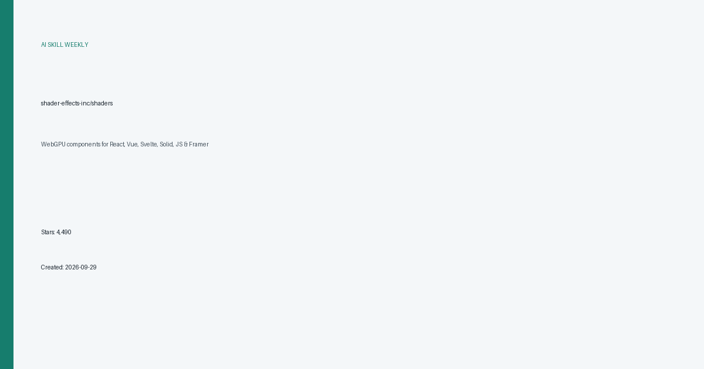
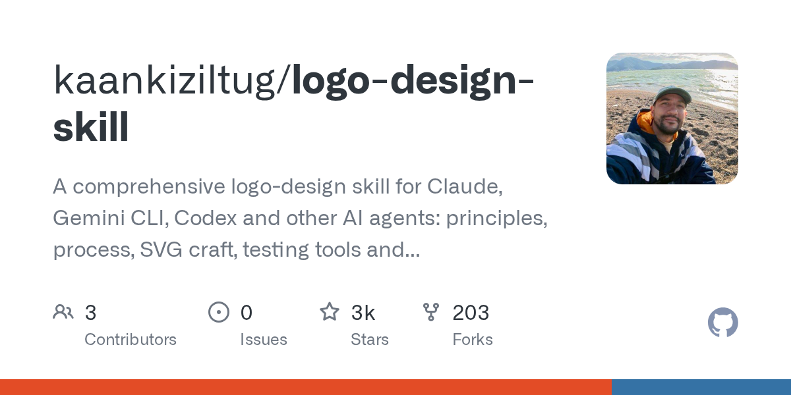
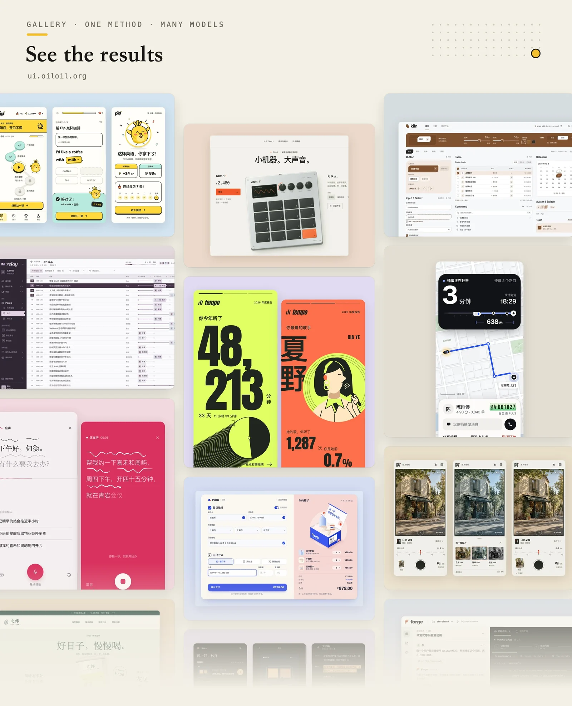
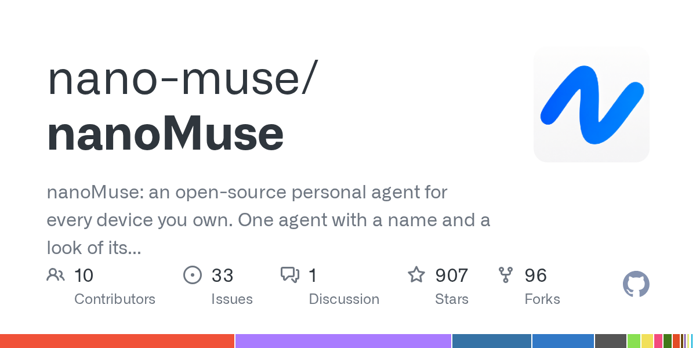

# AI 技能周报 2026-W42

本周报汇总近期值得关注的 AI Skill、Agent、MCP 与效率工具，帮助中文开发者快速了解它们的用途并完成初步筛选。内容基于公开仓库信息整理，使用前请自行核验。

检索窗口：近 30 天。精选 5 个未发布项目。

## 1. [shader-effects-inc/shaders](https://github.com/shader-effects-inc/shaders)

**近 12 天创建** · 4,490 Stars · TypeScript

**它是做什么的：**

这是一个值得进一步了解的 AI 项目；原始简介：WebGPU components for React, Vue, Svelte, Solid, JS & Framer

亮点：
- GitHub Stars：4,490
- 主要语言：TypeScript
- 内容来自公开仓库元数据，发布前建议人工核对 README。

适用场景：
- 评估其在 AI Agent、MCP 或开发工具工作流中的适用性

图片来源：本地信息卡 (本地生成)

## 2. [kaankiziltug/logo-design-skill](https://github.com/kaankiziltug/logo-design-skill)

**近 15 天创建** · 2,798 Stars · HTML

**它是做什么的：**

这是一个值得进一步了解的 AI 项目；原始简介：A comprehensive logo-design skill for Claude, Gemini CLI, Codex and other AI agents: principles, process, SVG craft, testing tools and a 1,400+ logo reference library.

亮点：
- GitHub Stars：2,798
- 主要语言：HTML
- 内容来自公开仓库元数据，发布前建议人工核对 README。

适用场景：
- 评估其在 AI Agent、MCP 或开发工具工作流中的适用性

图片来源：GitHub Open Graph (https://opengraph.githubassets.com/ai-skill-weekly/kaankiziltug/logo-design-skill)

## 3. [oil-oil/oil-ui](https://github.com/oil-oil/oil-ui)

**近 12 天创建** · 1,291 Stars · Python

**它是做什么的：**

这是一个值得进一步了解的 AI 项目；原始简介：UI design skill for Claude Code, Codex and other AI agents: explore distinct directions, compare them side by side, refine against real screenshots. 给 AI Agent 用的 UI 设计 Skill。

亮点：
- GitHub Stars：1,291
- 主要语言：Python
- 内容来自公开仓库元数据，发布前建议人工核对 README。

适用场景：
- 评估其在 AI Agent、MCP 或开发工具工作流中的适用性

图片来源：README (https://raw.githubusercontent.com/oil-oil/oil-ui/main/assets/readme/showcase.en.webp)

## 4. [amontlabs/lcu](https://github.com/amontlabs/lcu)

**近 19 天创建** · 955 Stars · JavaScript

**它是做什么的：**

这是一个值得进一步了解的 AI 项目；原始简介：Codex computer use, decoupled from the app, for usage inside any harness.

亮点：
- GitHub Stars：955
- 主要语言：JavaScript
- 内容来自公开仓库元数据，发布前建议人工核对 README。

适用场景：
- 评估其在 AI Agent、MCP 或开发工具工作流中的适用性

图片来源：README (https://raw.githubusercontent.com/amontlabs/lcu/main/docs/assets/approval-demo.gif)

## 5. [nano-muse/nanoMuse](https://github.com/nano-muse/nanoMuse)

**近 19 天创建** · 907 Stars · Swift

**它是做什么的：**

这是一个值得进一步了解的 AI 项目；原始简介：nanoMuse: an open-source personal agent for every device you own. One agent with a name and a look of its own that does things, keeps working while the app is closed, remembers you, and asks before anything you cannot undo. On Android, iPhone and iPad, Windows / macOS / Linux and in the browser; your phone's screen and your computer as its hands.

亮点：
- GitHub Stars：907
- 主要语言：Swift
- 内容来自公开仓库元数据，发布前建议人工核对 README。

适用场景：
- 评估其在 AI Agent、MCP 或开发工具工作流中的适用性

图片来源：GitHub Open Graph (https://opengraph.githubassets.com/ai-skill-weekly/nano-muse/nanoMuse)

---

本周报仅整理公开信息，不代表安全审计或使用推荐；引入项目前请核对许可证、权限和数据处理方式。
