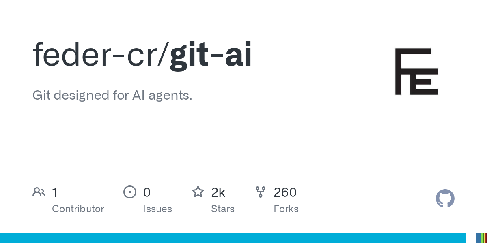
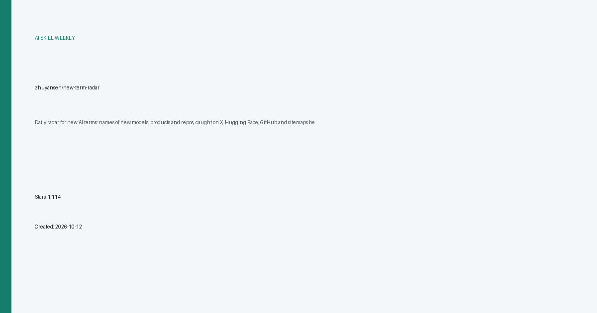
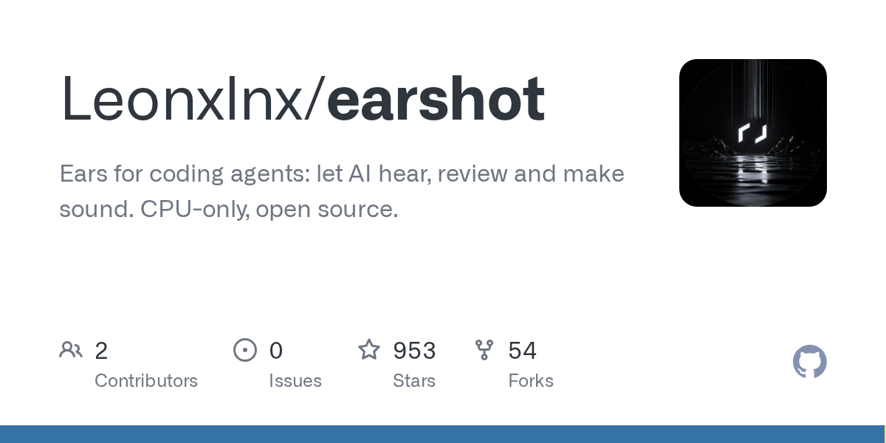
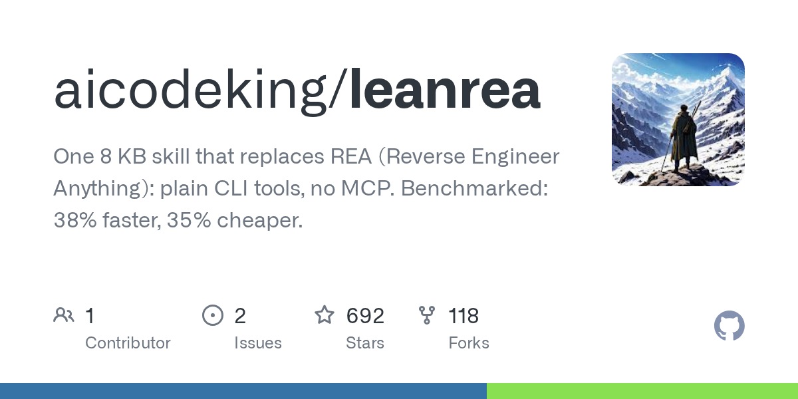

# AI 技能周报 2026-W43

本周报汇总近期值得关注的 AI Skill、Agent、MCP 与效率工具，帮助中文开发者快速了解它们的用途并完成初步筛选。内容基于公开仓库信息整理，使用前请自行核验。

检索窗口：近 7 天。精选 5 个未发布项目。

## 1. [feder-cr/git-ai](https://github.com/feder-cr/git-ai)

**本周新增** · 2,321 Stars · Go

**它是做什么的：**

这是一个值得进一步了解的 AI 项目；原始简介：Git designed for AI agents.

亮点：
- GitHub Stars：2,321
- 主要语言：Go
- 内容来自公开仓库元数据，发布前建议人工核对 README。

适用场景：
- 评估其在 AI Agent、MCP 或开发工具工作流中的适用性

图片来源：GitHub Open Graph (https://opengraph.githubassets.com/ai-skill-weekly/feder-cr/git-ai)

## 2. [zhuyansen/new-term-radar](https://github.com/zhuyansen/new-term-radar)

**本周新增** · 1,114 Stars · Python

**它是做什么的：**

这是一个值得进一步了解的 AI 项目；原始简介：Daily radar for new AI terms: names of new models, products and repos, caught on X, Hugging Face, GitHub and sitemaps before keyword tools list them.

亮点：
- GitHub Stars：1,114
- 主要语言：Python
- 内容来自公开仓库元数据，发布前建议人工核对 README。

适用场景：
- 评估其在 AI Agent、MCP 或开发工具工作流中的适用性

图片来源：本地信息卡 (本地生成)

## 3. [Leonxlnx/earshot](https://github.com/Leonxlnx/earshot)

**本周新增** · 953 Stars · Python

**它是做什么的：**

这是一个值得进一步了解的 AI 项目；原始简介：Ears for coding agents: let AI hear, review and make sound. CPU-only, open source.

亮点：
- GitHub Stars：953
- 主要语言：Python
- 内容来自公开仓库元数据，发布前建议人工核对 README。

适用场景：
- 评估其在 AI Agent、MCP 或开发工具工作流中的适用性

图片来源：GitHub Open Graph (https://opengraph.githubassets.com/ai-skill-weekly/Leonxlnx/earshot)

## 4. [LiCinCan/blender-ai-mcp-addon](https://github.com/LiCinCan/blender-ai-mcp-addon)

**本周新增** · 790 Stars · Python

**它是做什么的：**

这是一个值得进一步了解的 AI 项目；原始简介：AI assistant and MCP server for Blender: visual chat, scene tools, multi-agent workflows. Works with OpenAI, ChatGPT, Claude, Gemini, Ollama, OpenCode. Blender AI addon and plugin, copilot for 3D, bpy Python scripting, MCP integration.

亮点：
- GitHub Stars：790
- 主要语言：Python
- 内容来自公开仓库元数据，发布前建议人工核对 README。

适用场景：
- 评估其在 AI Agent、MCP 或开发工具工作流中的适用性

图片来源：README (https://raw.githubusercontent.com/LiCinCan/blender-ai-mcp-addon/main/docs/images/studio.png)

## 5. [aicodeking/leanrea](https://github.com/aicodeking/leanrea)

**本周新增** · 692 Stars · Python

**它是做什么的：**

这是一个值得进一步了解的 AI 项目；原始简介：One 8 KB skill that replaces REA (Reverse Engineer Anything): plain CLI tools, no MCP. Benchmarked: 38% faster, 35% cheaper.

亮点：
- GitHub Stars：692
- 主要语言：Python
- 内容来自公开仓库元数据，发布前建议人工核对 README。

适用场景：
- 评估其在 AI Agent、MCP 或开发工具工作流中的适用性

图片来源：GitHub Open Graph (https://opengraph.githubassets.com/ai-skill-weekly/aicodeking/leanrea)

---

本周报仅整理公开信息，不代表安全审计或使用推荐；引入项目前请核对许可证、权限和数据处理方式。
