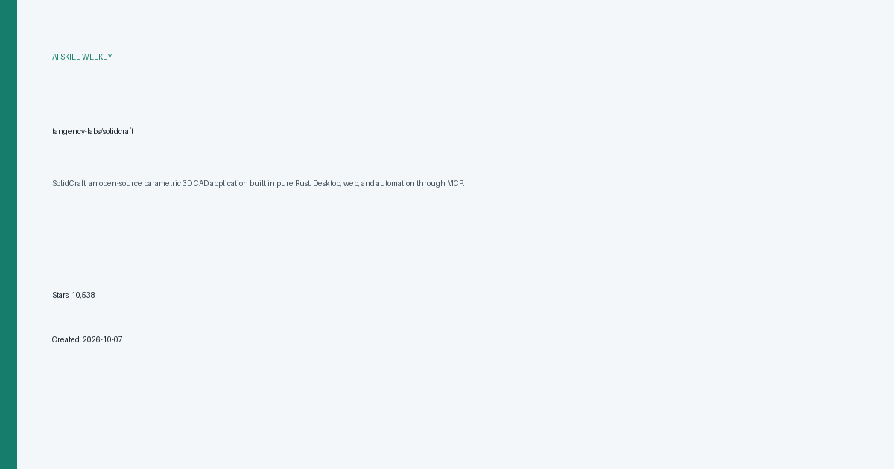
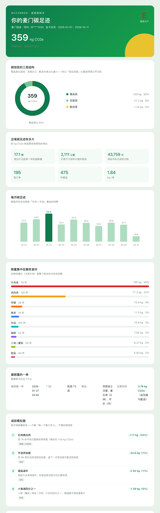
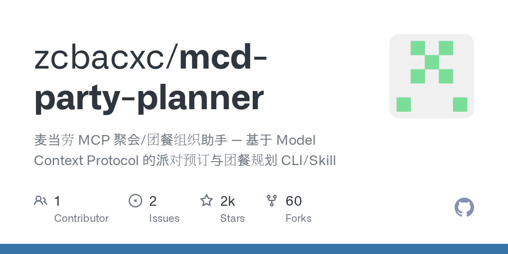
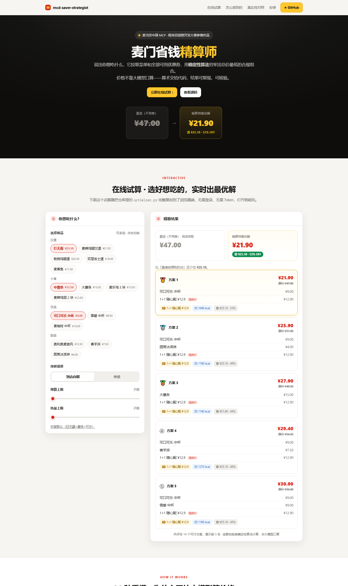

# AI 技能周报 2026-W44

本周报汇总近期值得关注的 AI Skill、Agent、MCP 与效率工具，帮助中文开发者快速了解它们的用途并完成初步筛选。内容基于公开仓库信息整理，使用前请自行核验。

检索窗口：近 30 天。精选 5 个未发布项目。

## 1. [tangency-labs/solidcraft](https://github.com/tangency-labs/solidcraft)

**近 18 天创建** · 10,538 Stars · Rust

**它是做什么的：**

这是一个值得进一步了解的 AI 项目；原始简介：SolidCraft: an open-source parametric 3D CAD application built in pure Rust. Desktop, web, and automation through MCP.

亮点：
- GitHub Stars：10,538
- 主要语言：Rust
- 内容来自公开仓库元数据，发布前建议人工核对 README。

适用场景：
- 评估其在 AI Agent、MCP 或开发工具工作流中的适用性

图片来源：本地信息卡 (本地生成)

## 2. [yeqv111/mccarbon](https://github.com/yeqv111/mccarbon)

**近 13 天创建** · 1,935 Stars · Python

**它是做什么的：**

这是一个值得进一步了解的 AI 项目；原始简介：麦麦碳账本 · 基于麦当劳 MCP 的个人餐饮碳足迹估算与减排模拟器 | Personal dining carbon footprint estimator powered by McDonald's MCP

亮点：
- GitHub Stars：1,935
- 主要语言：Python
- 内容来自公开仓库元数据，发布前建议人工核对 README。

适用场景：
- 评估其在 AI Agent、MCP 或开发工具工作流中的适用性

图片来源：README (https://raw.githubusercontent.com/yeqv111/mccarbon/main/examples/carbon-book.html.png)

## 3. [trhhubsd/ARTEX](https://github.com/trhhubsd/ARTEX)

**近 17 天创建** · 1,930 Stars · Go

**它是做什么的：**

这是一个值得进一步了解的 AI 项目；原始简介：ARTEX · AI autonomous penetration testing system (multi-agent LLM, Go + Next.js) · AI 自主渗透测试系统 · 百度 agent+ 攻防挑战赛冠军

亮点：
- GitHub Stars：1,930
- 主要语言：Go
- 内容来自公开仓库元数据，发布前建议人工核对 README。

适用场景：
- 评估其在 AI Agent、MCP 或开发工具工作流中的适用性

图片来源：README (https://raw.githubusercontent.com/trhhubsd/ARTEX/main/screenshots/dashboard.png)

## 4. [zcbacxc/mcd-party-planner](https://github.com/zcbacxc/mcd-party-planner)

**近 10 天创建** · 1,600 Stars · Python

**它是做什么的：**

这是一个值得进一步了解的 AI 项目；原始简介：麦当劳 MCP 聚会/团餐组织助手 — 基于 Model Context Protocol 的派对预订与团餐规划 CLI/Skill

亮点：
- GitHub Stars：1,600
- 主要语言：Python
- 内容来自公开仓库元数据，发布前建议人工核对 README。

适用场景：
- 评估其在 AI Agent、MCP 或开发工具工作流中的适用性

图片来源：GitHub Open Graph (https://opengraph.githubassets.com/ai-skill-weekly/zcbacxc/mcd-party-planner)

## 5. [hujjun/mcd-saver-strategist](https://github.com/hujjun/mcd-saver-strategist)

**近 17 天创建** · 1,519 Stars · Python

**它是做什么的：**

这是一个值得进一步了解的 AI 项目；原始简介：麦当劳省钱点餐助手（麦门精算师）｜麦当劳优惠券组合优化 Skill：拉取麦当劳菜单与全部可用优惠券，算出最省的点餐组合，巨无霸套餐 ¥47 → ¥21.9（省 53%）。McDonalds MCP（麦当劳 MCP）coupon optimizer · McDonalds China MCP Server · Agent Skill for WorkBuddy · 麦当劳程序员创意开发大赛参赛作品

亮点：
- GitHub Stars：1,519
- 主要语言：Python
- 内容来自公开仓库元数据，发布前建议人工核对 README。

适用场景：
- 评估其在 AI Agent、MCP 或开发工具工作流中的适用性

图片来源：README (https://raw.githubusercontent.com/hujjun/mcd-saver-strategist/main/docs/preview.png)

---

本周报仅整理公开信息，不代表安全审计或使用推荐；引入项目前请核对许可证、权限和数据处理方式。
