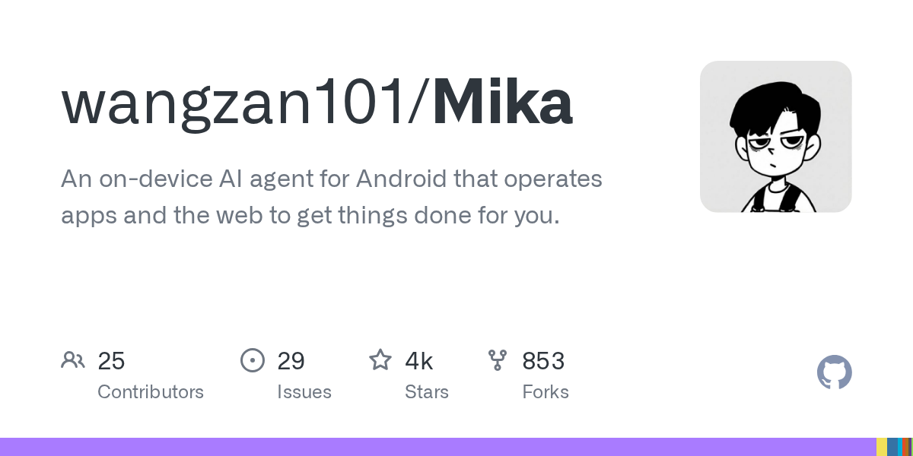
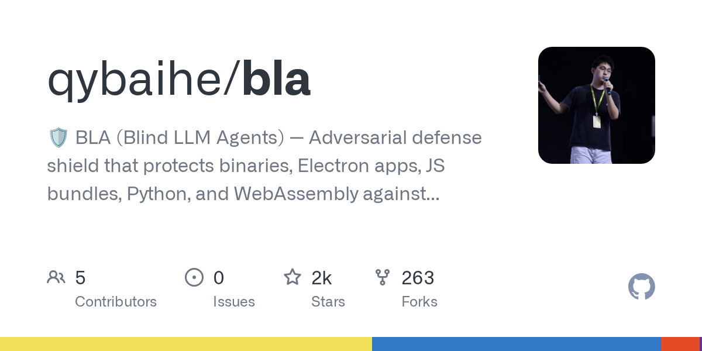
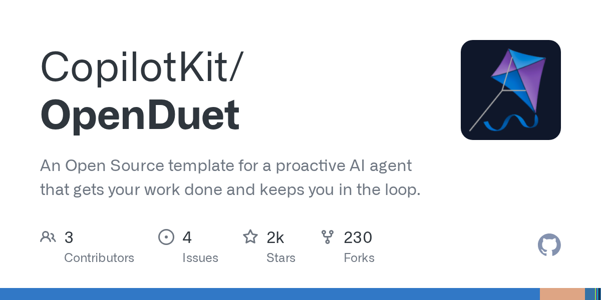
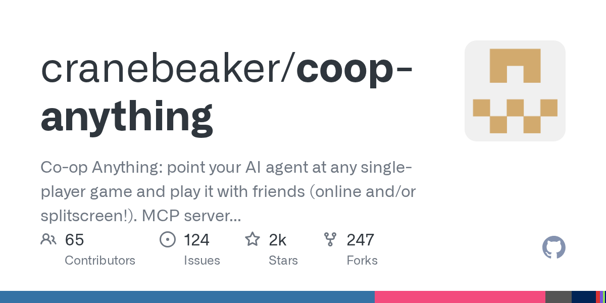
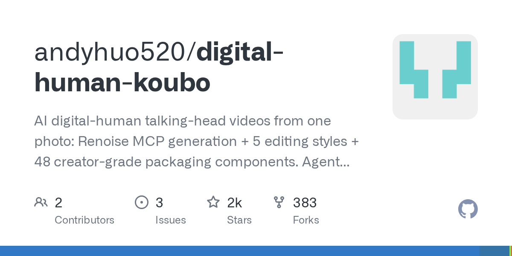

# AI 技能周报 2026-W45

本周报汇总近期值得关注的 AI Skill、Agent、MCP 与效率工具，帮助中文开发者快速了解它们的用途并完成初步筛选。内容基于公开仓库信息整理，使用前请自行核验。

检索窗口：近 30 天。精选 5 个未发布项目。

## 1. [wangzan101/Mika](https://github.com/wangzan101/Mika)

**本周新增** · 4,481 Stars · Kotlin

**它是做什么的：**

这是一个值得进一步了解的 AI 项目；原始简介：An on-device AI agent for Android that operates apps and the web to get things done for you.

亮点：
- GitHub Stars：4,481
- 主要语言：Kotlin
- 内容来自公开仓库元数据，发布前建议人工核对 README。

适用场景：
- 评估其在 AI Agent、MCP 或开发工具工作流中的适用性

图片来源：GitHub Open Graph (https://opengraph.githubassets.com/ai-skill-weekly/wangzan101/Mika)

## 2. [qybaihe/bla](https://github.com/qybaihe/bla)

**近 8 天创建** · 1,890 Stars · JavaScript

**它是做什么的：**

这是一个值得进一步了解的 AI 项目；原始简介：🛡️ BLA (Blind LLM Agents) — Adversarial defense shield that protects binaries, Electron apps, JS bundles, Python, and WebAssembly against AI reverse-engineering agents like REA. Poison -> Exhaust -> Hallucinate.

亮点：
- GitHub Stars：1,890
- 主要语言：JavaScript
- 内容来自公开仓库元数据，发布前建议人工核对 README。

适用场景：
- 评估其在 AI Agent、MCP 或开发工具工作流中的适用性

图片来源：GitHub Open Graph (https://opengraph.githubassets.com/ai-skill-weekly/qybaihe/bla)

## 3. [CopilotKit/OpenDuet](https://github.com/CopilotKit/OpenDuet)

**近 11 天创建** · 1,813 Stars · TypeScript

**它是做什么的：**

这是一个值得进一步了解的 AI 项目；原始简介：An Open Source template for a proactive AI agent that gets your work done and keeps you in the loop.

亮点：
- GitHub Stars：1,813
- 主要语言：TypeScript
- 内容来自公开仓库元数据，发布前建议人工核对 README。

适用场景：
- 评估其在 AI Agent、MCP 或开发工具工作流中的适用性

图片来源：GitHub Open Graph (https://opengraph.githubassets.com/ai-skill-weekly/CopilotKit/OpenDuet)

## 4. [cranebeaker/coop-anything](https://github.com/cranebeaker/coop-anything)

**近 16 天创建** · 1,791 Stars · Python

**它是做什么的：**

这是一个值得进一步了解的 AI 项目；原始简介：Co-op Anything: point your AI agent at any single-player game and play it with friends (online and/or splitscreen!). MCP server and playbook to let you reverse engineer, fix, test, ship and share what it learns.

亮点：
- GitHub Stars：1,791
- 主要语言：Python
- 内容来自公开仓库元数据，发布前建议人工核对 README。

适用场景：
- 评估其在 AI Agent、MCP 或开发工具工作流中的适用性

图片来源：GitHub Open Graph (https://opengraph.githubassets.com/ai-skill-weekly/cranebeaker/coop-anything)

## 5. [andyhuo520/digital-human-koubo](https://github.com/andyhuo520/digital-human-koubo)

**本周新增** · 1,683 Stars · TypeScript

**它是做什么的：**

这是一个值得进一步了解的 AI 项目；原始简介：AI digital-human talking-head videos from one photo: Renoise MCP generation + 5 editing styles + 48 creator-grade packaging components. Agent skill for Claude Code / Codex / OpenClaw / WorkBuddy …

亮点：
- GitHub Stars：1,683
- 主要语言：TypeScript
- 内容来自公开仓库元数据，发布前建议人工核对 README。

适用场景：
- 评估其在 AI Agent、MCP 或开发工具工作流中的适用性

图片来源：GitHub Open Graph (https://opengraph.githubassets.com/ai-skill-weekly/andyhuo520/digital-human-koubo)

---

本周报仅整理公开信息，不代表安全审计或使用推荐；引入项目前请核对许可证、权限和数据处理方式。
