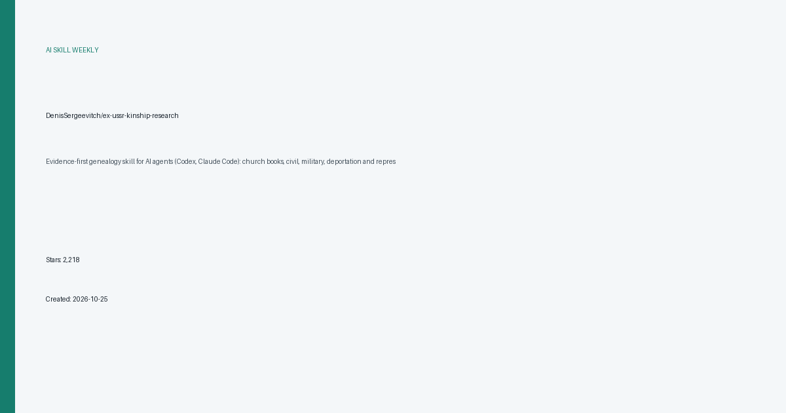
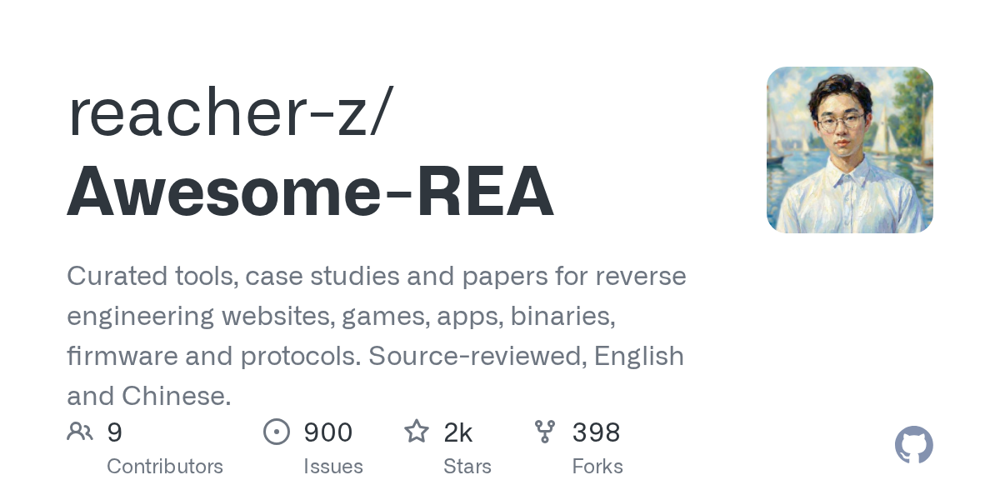
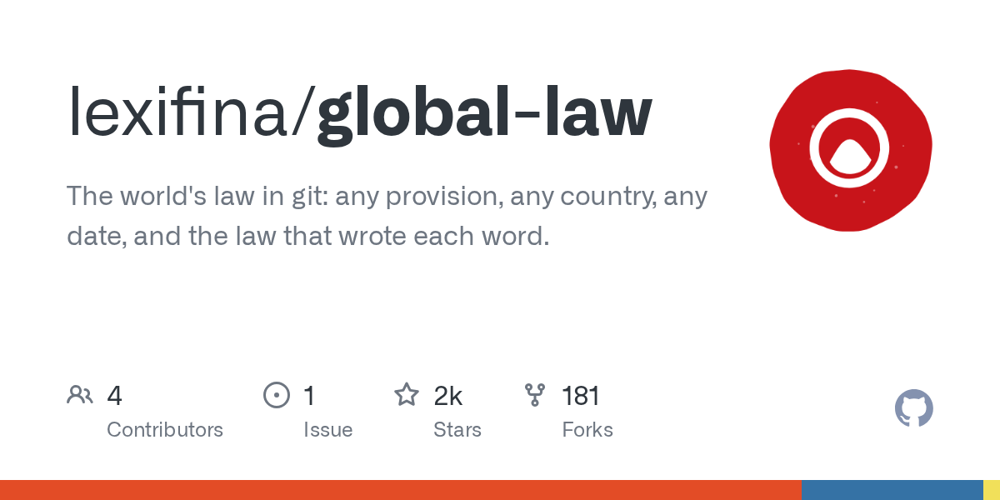

# AI 技能周报 2026-W46

本周报汇总近期值得关注的 AI Skill、Agent、MCP 与效率工具，帮助中文开发者快速了解它们的用途并完成初步筛选。内容基于公开仓库信息整理，使用前请自行核验。

检索窗口：近 30 天。精选 5 个未发布项目。

## 1. [KKKKhazix/agent-autoloop](https://github.com/KKKKhazix/agent-autoloop)

**本周新增** · 4,189 Stars · TypeScript

**它是做什么的：**

这是一个值得进一步了解的 AI 项目；原始简介：让你的命令行 Agent 在后台自己接活、自己跟进到底；平时不烦你，遇到拿不准的事才发卡片找你拍板。

亮点：
- GitHub Stars：4,189
- 主要语言：TypeScript
- 内容来自公开仓库元数据，发布前建议人工核对 README。

适用场景：
- 评估其在 AI Agent、MCP 或开发工具工作流中的适用性

图片来源：本地信息卡 (本地生成)

## 2. [DenisSergeevitch/ex-ussr-kinship-research](https://github.com/DenisSergeevitch/ex-ussr-kinship-research)

**近 14 天创建** · 2,218 Stars · Python

**它是做什么的：**

这是一个值得进一步了解的 AI 项目；原始简介：Evidence-first genealogy skill for AI agents (Codex, Claude Code): church books, civil, military, deportation and repression records across the former USSR. Replies in your language.

亮点：
- GitHub Stars：2,218
- 主要语言：Python
- 内容来自公开仓库元数据，发布前建议人工核对 README。

适用场景：
- 评估其在 AI Agent、MCP 或开发工具工作流中的适用性

图片来源：本地信息卡 (本地生成)

## 3. [reacher-z/Awesome-REA](https://github.com/reacher-z/Awesome-REA)

**近 24 天创建** · 2,177 Stars · Python

**它是做什么的：**

这是一个值得进一步了解的 AI 项目；原始简介：Curated tools, case studies and papers for reverse engineering websites, games, apps, binaries, firmware and protocols. Source-reviewed, English and Chinese.

亮点：
- GitHub Stars：2,177
- 主要语言：Python
- 内容来自公开仓库元数据，发布前建议人工核对 README。

适用场景：
- 评估其在 AI Agent、MCP 或开发工具工作流中的适用性

图片来源：GitHub Open Graph (https://opengraph.githubassets.com/ai-skill-weekly/reacher-z/Awesome-REA)

## 4. [lexifina/global-law](https://github.com/lexifina/global-law)

**近 11 天创建** · 1,892 Stars · HTML

**它是做什么的：**

这是一个值得进一步了解的 AI 项目；原始简介：The world's law in git: any provision, any country, any date, and the law that wrote each word.

亮点：
- GitHub Stars：1,892
- 主要语言：HTML
- 内容来自公开仓库元数据，发布前建议人工核对 README。

适用场景：
- 评估其在 AI Agent、MCP 或开发工具工作流中的适用性

图片来源：GitHub Open Graph (https://opengraph.githubassets.com/ai-skill-weekly/lexifina/global-law)

## 5. [reason-machines/reason-network](https://github.com/reason-machines/reason-network)

**近 23 天创建** · 1,685 Stars · Rust

**它是做什么的：**

这是一个值得进一步了解的 AI 项目；原始简介：Reason Network: your team's coding agents, talking to each other. The engine behind `reason network`.

亮点：
- GitHub Stars：1,685
- 主要语言：Rust
- 内容来自公开仓库元数据，发布前建议人工核对 README。

适用场景：
- 评估其在 AI Agent、MCP 或开发工具工作流中的适用性

图片来源：本地信息卡 (本地生成)

---

本周报仅整理公开信息，不代表安全审计或使用推荐；引入项目前请核对许可证、权限和数据处理方式。
