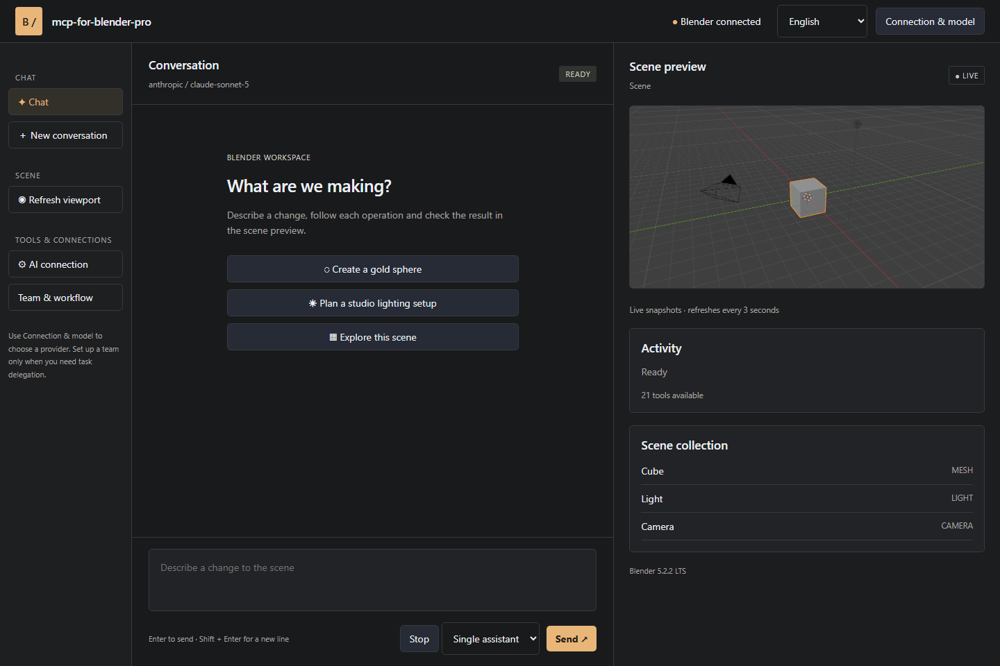
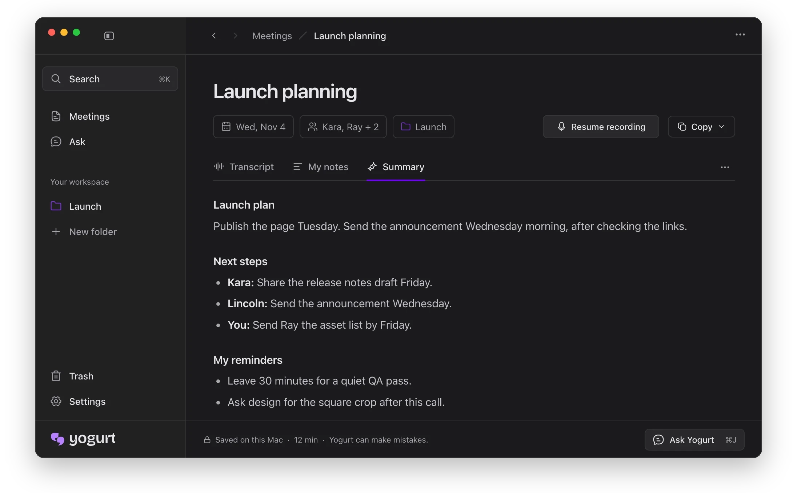
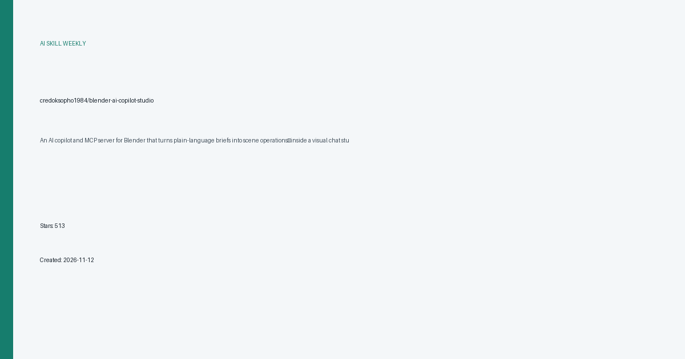

# AI 技能周报 2026-W47

本周报汇总近期值得关注的 AI Skill、Agent、MCP 与效率工具，帮助中文开发者快速了解它们的用途并完成初步筛选。内容基于公开仓库信息整理，使用前请自行核验。

检索窗口：近 7 天。精选 5 个未发布项目。

## 1. [hitkeeen/blender-ai-mcp-addon](https://github.com/hitkeeen/blender-ai-mcp-addon)

**本周新增** · 1,857 Stars · 语言未标注

**它是做什么的：**

这是一个值得进一步了解的 AI 项目；原始简介：AI assistant and MCP server for Blender: visual chat, scene tools, multi-agent workflows. Works with ChatGPT/GPT, Claude, Gemini, Ollama, OpenCode. Blender AI addon, copilot for 3D, bpy Python scripting, MCP integration.

亮点：
- GitHub Stars：1,857
- 主要语言：未标注
- 内容来自公开仓库元数据，发布前建议人工核对 README。

适用场景：
- 评估其在 AI Agent、MCP 或开发工具工作流中的适用性

图片来源：README (https://raw.githubusercontent.com/hitkeeen/blender-ai-mcp-addon/main/docs/images/studio.png)

## 2. [FrigadeHQ/yogurt](https://github.com/FrigadeHQ/yogurt)

**本周新增** · 1,719 Stars · TypeScript

**它是做什么的：**

这是一个值得进一步了解的 AI 项目；原始简介：Private AI meeting notes that stay on your computer. A free, open-source alternative to Granola for Mac, Windows and Linux.

亮点：
- GitHub Stars：1,719
- 主要语言：TypeScript
- 内容来自公开仓库元数据，发布前建议人工核对 README。

适用场景：
- 评估其在 AI Agent、MCP 或开发工具工作流中的适用性

图片来源：README (https://raw.githubusercontent.com/FrigadeHQ/yogurt/main/docs/assets/yogurt-screenshot.webp)

## 3. [credoksopho1984/blender-ai-copilot-studio](https://github.com/credoksopho1984/blender-ai-copilot-studio)

**本周新增** · 513 Stars · 语言未标注

**它是做什么的：**

这是一个值得进一步了解的 AI 项目；原始简介：An AI copilot and MCP server for Blender that turns plain-language briefs into scene operations—inside a visual chat studio with multi-agent teams, your choice of AI models, and 27 built-in scene tools. · blender-ai-copilot-studio · blender ai · ai for blender · blender copilot · blender ai copilot · blender ai assistant · blender mcp server

亮点：
- GitHub Stars：513
- 主要语言：未标注
- 内容来自公开仓库元数据，发布前建议人工核对 README。

适用场景：
- 评估其在 AI Agent、MCP 或开发工具工作流中的适用性

图片来源：本地信息卡 (本地生成)

## 4. [racdeufindurch198812/Blender-AI-MCP-Studio](https://github.com/racdeufindurch198812/Blender-AI-MCP-Studio)

**本周新增** · 511 Stars · 语言未标注

**它是做什么的：**

这是一个值得进一步了解的 AI 项目；原始简介：Blender AI MCP Studio is an AI assistant and built-in Model Context Protocol MCP server for Blender that turns plain-language briefs into inspected, approved and reversible 3D scene operations — with a visual chat workspace, multi-agent teams and your choice of AI models. · blender ai mcp studio · mcp-for-blender · mcp for blender pro

亮点：
- GitHub Stars：511
- 主要语言：未标注
- 内容来自公开仓库元数据，发布前建议人工核对 README。

适用场景：
- 评估其在 AI Agent、MCP 或开发工具工作流中的适用性

图片来源：本地信息卡 (本地生成)

## 5. [tiobeharxi1987/blender-ai-copilot-flow](https://github.com/tiobeharxi1987/blender-ai-copilot-flow)

**本周新增** · 510 Stars · 语言未标注

**它是做什么的：**

这是一个值得进一步了解的 AI 项目；原始简介：A controlled AI workflow for Blender: every copilot edit is a supervised tool call—proposed, approved, executed in sequence, cancellable after the current step and undoable by name—inside a visual studio with a built-in MCP server. · blender-ai-copilot-flow · blender · blender 3d · blender addon · blender plugin · blender extension

亮点：
- GitHub Stars：510
- 主要语言：未标注
- 内容来自公开仓库元数据，发布前建议人工核对 README。

适用场景：
- 评估其在 AI Agent、MCP 或开发工具工作流中的适用性

图片来源：本地信息卡 (本地生成)

---

本周报仅整理公开信息，不代表安全审计或使用推荐；引入项目前请核对许可证、权限和数据处理方式。
