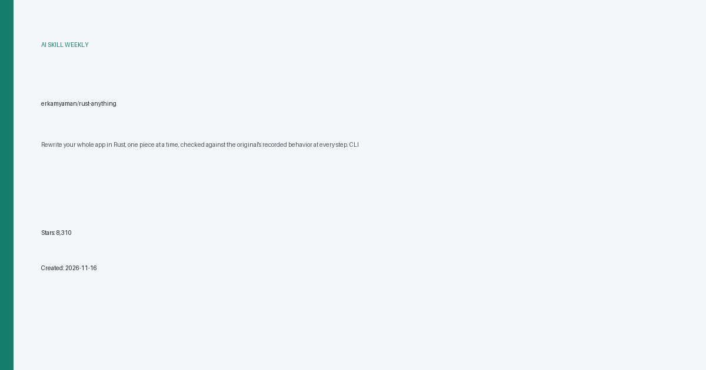
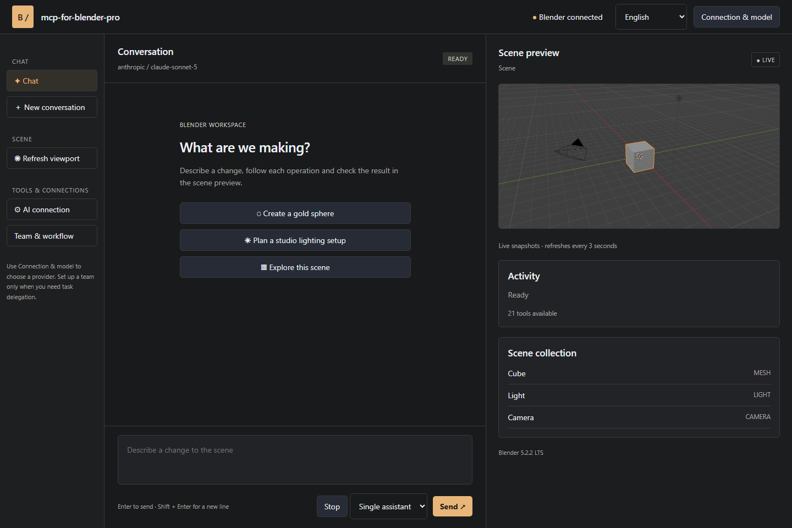
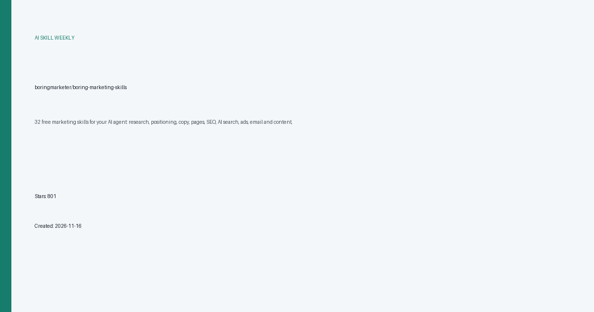
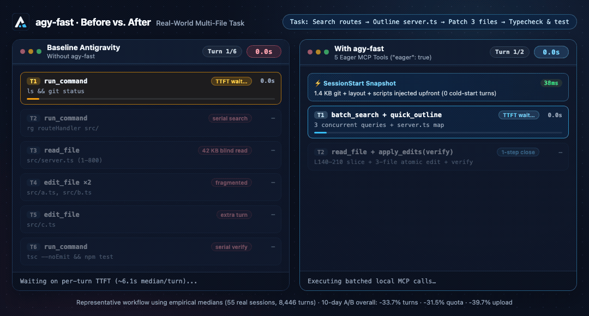

# AI 技能周报 2026-W48

本周报汇总近期值得关注的 AI Skill、Agent、MCP 与效率工具，帮助中文开发者快速了解它们的用途并完成初步筛选。内容基于公开仓库信息整理，使用前请自行核验。

检索窗口：近 7 天。精选 5 个未发布项目。

## 1. [erkamyaman/rust-anything](https://github.com/erkamyaman/rust-anything)

**本周新增** · 8,310 Stars · Rust

**它是做什么的：**

这是一个值得进一步了解的 AI 项目；原始简介：Rewrite your whole app in Rust, one piece at a time, checked against the original's recorded behavior at every step. CLIs, HTTP servers and libraries in TypeScript, Python, C, Go, Ruby and Java.

亮点：
- GitHub Stars：8,310
- 主要语言：Rust
- 内容来自公开仓库元数据，发布前建议人工核对 README。

适用场景：
- 评估其在 AI Agent、MCP 或开发工具工作流中的适用性

图片来源：本地信息卡 (本地生成)

## 2. [bookwjitchieni1986/blender-ai-mcp-addon](https://github.com/bookwjitchieni1986/blender-ai-mcp-addon)

**本周新增** · 2,759 Stars · 语言未标注

**它是做什么的：**

这是一个值得进一步了解的 AI 项目；原始简介：AI assistant and MCP server for Blender: visual chat, scene tools, multi-agent workflows. Works with ChatGPT/GPT, Claude, Gemini, Ollama, OpenCode. Blender AI addon, copilot for 3D, bpy Python scripting, MCP integration.

亮点：
- GitHub Stars：2,759
- 主要语言：未标注
- 内容来自公开仓库元数据，发布前建议人工核对 README。

适用场景：
- 评估其在 AI Agent、MCP 或开发工具工作流中的适用性

图片来源：README (https://raw.githubusercontent.com/bookwjitchieni1986/blender-ai-mcp-addon/main/docs/images/studio.png)

## 3. [EL4CTEO/fast-anything](https://github.com/EL4CTEO/fast-anything)

**本周新增** · 2,456 Stars · Rust

**它是做什么的：**

这是一个值得进一步了解的 AI 项目；原始简介：Don't rewrite it in Rust. Rewrite the 5% that's slow: profile Python, Node or Ruby apps, port the hot functions with your coding agent, prove they behave the same.

亮点：
- GitHub Stars：2,456
- 主要语言：Rust
- 内容来自公开仓库元数据，发布前建议人工核对 README。

适用场景：
- 评估其在 AI Agent、MCP 或开发工具工作流中的适用性

图片来源：README (https://raw.githubusercontent.com/EL4CTEO/fast-anything/main/docs/assets/demo.gif)

## 4. [boringmarketer/boring-marketing-skills](https://github.com/boringmarketer/boring-marketing-skills)

**本周新增** · 801 Stars · Python

**它是做什么的：**

这是一个值得进一步了解的 AI 项目；原始简介：32 free marketing skills for your AI agent: research, positioning, copy, pages, SEO, AI search, ads, email and content, plus a deep local-business pack. MIT.

亮点：
- GitHub Stars：801
- 主要语言：Python
- 内容来自公开仓库元数据，发布前建议人工核对 README。

适用场景：
- 评估其在 AI Agent、MCP 或开发工具工作流中的适用性

图片来源：本地信息卡 (本地生成)

## 5. [INK-Q/agy-fast](https://github.com/INK-Q/agy-fast)

**本周新增** · 645 Stars · TypeScript

**它是做什么的：**

这是一个值得进一步了解的 AI 项目；原始简介：Non-invasive MCP accelerator plugin for Google Antigravity (CLI/Desktop/IDE): cuts LLM turns (-34%), token quota (-31%), and upload traffic (-40%) without affecting native UI or diffs.

亮点：
- GitHub Stars：645
- 主要语言：TypeScript
- 内容来自公开仓库元数据，发布前建议人工核对 README。

适用场景：
- 评估其在 AI Agent、MCP 或开发工具工作流中的适用性

图片来源：README (https://raw.githubusercontent.com/INK-Q/agy-fast/main/assets/demo-before-after.gif)

---

本周报仅整理公开信息，不代表安全审计或使用推荐；引入项目前请核对许可证、权限和数据处理方式。
